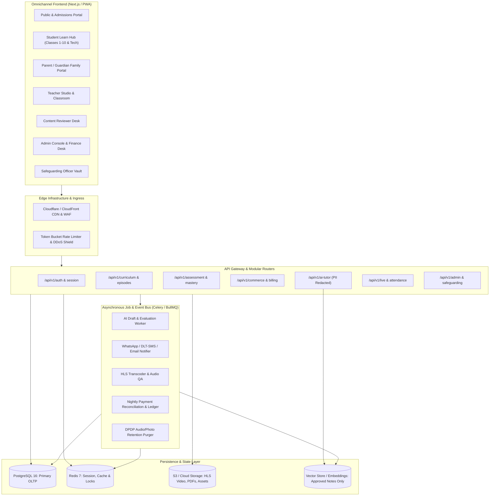
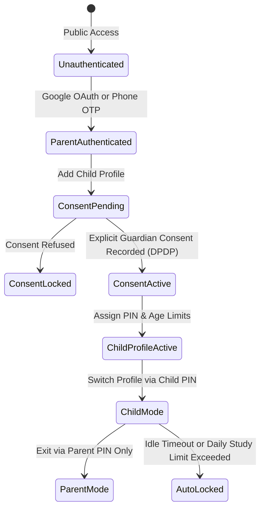
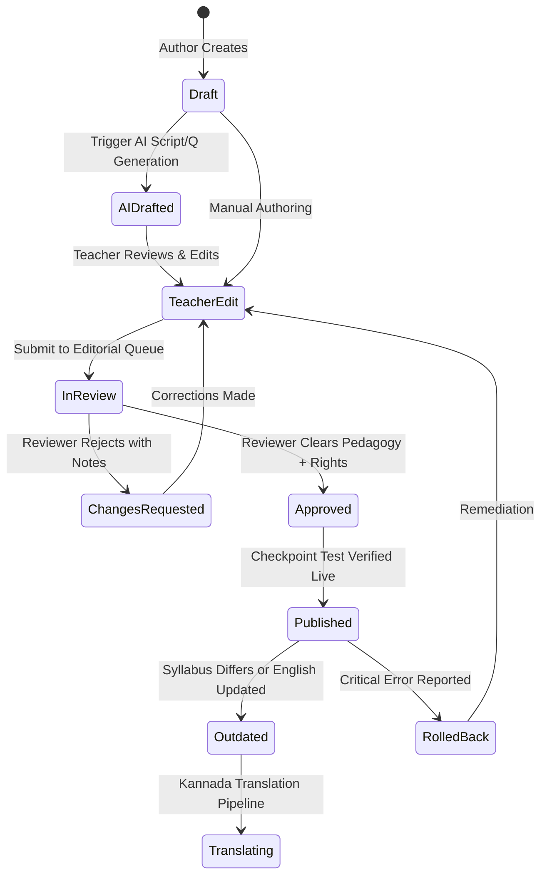
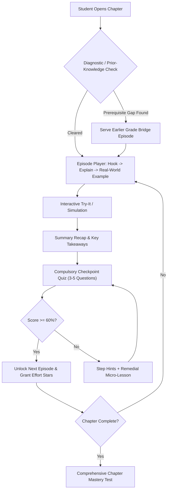
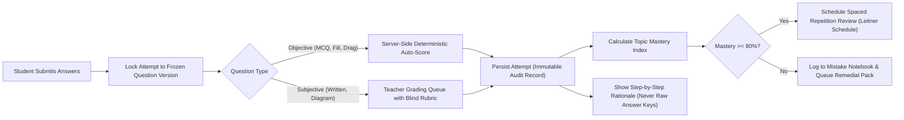
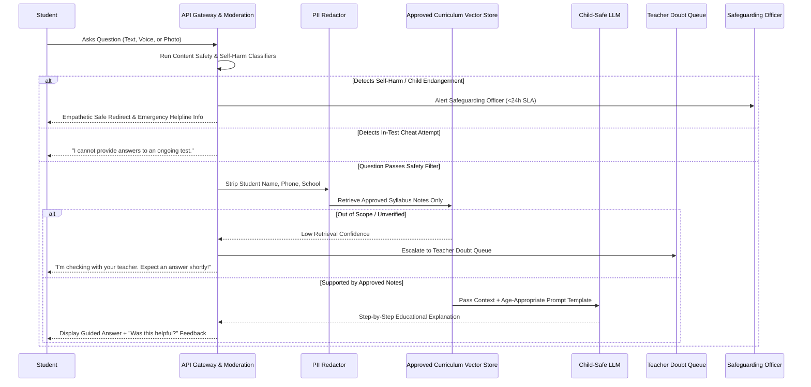
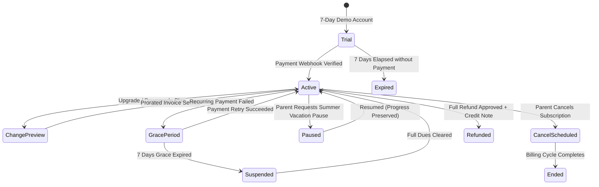
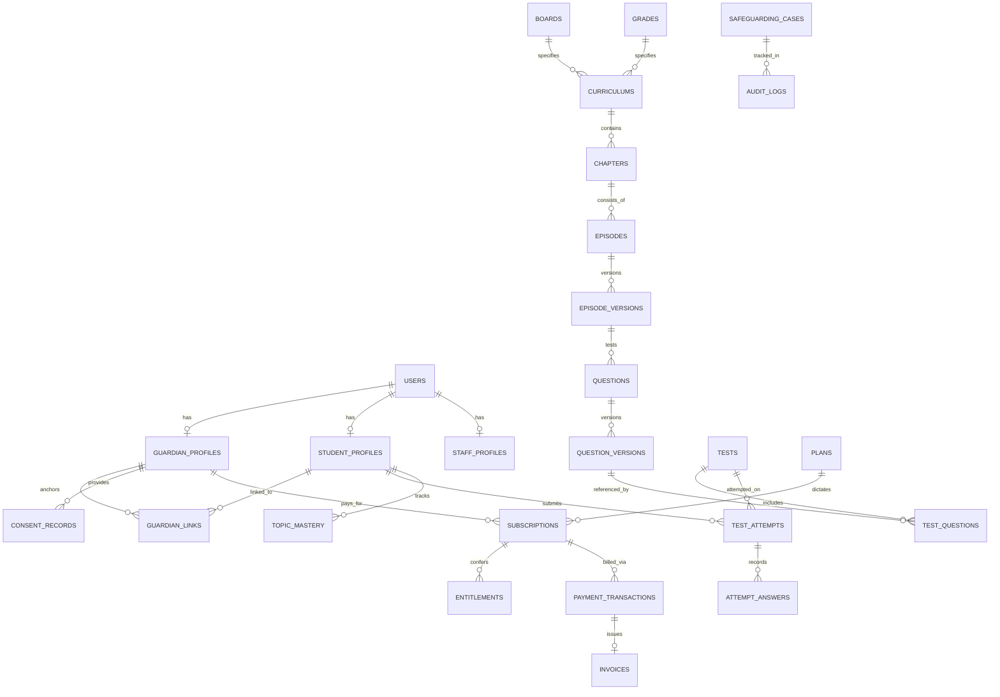
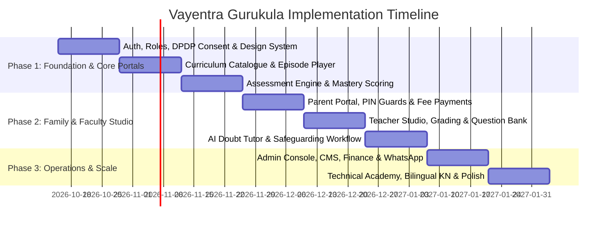

# Vayentra Gurukula Platform: Master Architectural Blueprint & Implementation Plan

> **Product Scope**: Unified Learning Platform comprising:
> 1. **AI School Academy**: Classes 1–10 across CBSE, CISCE/ICSE, and Karnataka State Board (English & Kannada mediums).
> 2. **Technical & Professional Academy**: Modular tracks, project sandboxes, lab evaluations, and accredited certifications.
> 
> **Source of Truth Reference**:
> - 100 Developer Design Diagrams (`design_diagrams.md` / `Vayentra Developer Design Diagrams (2).md`)
> - 75 Screen Stories (`PS-01` to `PS-75` from SRS Addendum v1.2)
> - Consolidated Requirements V2.0 (`Vayentra_Learning_Platform_Requirements_V2.docx`)
> - UI/UX SRS V1.0 (`Vayentra_UI_UX_SRS_V1.docx`)
> - Backend & Database Schema SRS V1.0 (`Vayentra_Backend_Schema_SRS_V1.docx`)
> - Designer Pack Wireframes (`Vayentra Designer Pack Wireframes.html`)

---

## 1. Executive Architecture & Core System Topology

### Core Architecture Highlights
1. **Single Backend Foundation, Dual Academies**: A multi-tenant, modular monorepo powering both K-10 schooling and the Technical Academy with strict data isolation.
2. **Zero-Trust Child Safety (DPDP & COPPA Aligned)**:
   - Direct logins restricted for minors under 13.
   - Guardian-anchored account structure with mandatory explicit consent capture (version, timestamp, IP) before processing any minor's telemetry.
   - Separate PIN-gated profiles on shared devices. Zero advertisements, zero third-party trackers, zero open student-to-student text chat.
3. **AI-Assisted, Educator-Approved ("Human-in-the-Loop")**:
   - AI drafts scripts and questions; only human-reviewed content can ever reach `Published` status (AT-08 constraint).
   - Real-time student doubt tutor restricted to approved curriculum embeddings; strictly refuses to solve active test questions.
4. **Offline-Resilient, Bandwidth-Adaptive**:
   - Tiered media pipeline: Full HD video $\rightarrow$ Lightweight Audio+Slides ($<2\text{ MB}$) $\rightarrow$ Offline-cached notes with idempotent synchronization upon network recovery.

---

## 2. Exhaustive Analysis: All 100 Design Diagrams

The 100 developer design diagrams are organized below into **10 Functional Clusters**, analyzing the architectural requirements, state machines, data models, and edge cases for every single diagram.

---

### Cluster 1: Core System Architecture, Ingress & Platform Operations
*(Diagrams 1, 19, 40, 60, 63, 64, 65, 70, 71, 84, 85, 94, 95)*

| Diagram # | Title | Core Architectural Specification & Invariants | Mapped Stories & Requirements | Key Entities & Data Touchpoints |
|---|---|---|---|---|
| **#1** | **System Architecture** | Modular backend (FastAPI/Django/Next.js) with CDN edge, PostgreSQL DB, Redis cache/queue, Object Storage (HLS video, PDFs), and queue workers for AI and messaging. | PS-01, PS-60, FR-ARC | `users`, `sessions`, `redis_queues`, `s3_assets` |
| **#19** | **Deployment, CI/CD & Operations** | CI test pipeline with dependency scanning, staging environment with seeded fixtures, QA acceptance suites (AT-01 to AT-15), automated daily Postgres backups in India region, monthly restore tests. | FR-ENG-01 to 04 | `deploy_logs`, `backup_manifest`, `health_check` |
| **#40** | **System Context v1.1** | External integration layer: Search Index, Live Class Webhooks (Zoom/100ms), Notification Providers (WhatsApp Cloud API, DLT-SMS, SES), Payment Gateways (Razorpay/Cashfree), and Real User Monitoring (RUM). | FR-SYS-01 to 06 | `telemetry_events`, `rum_vitals`, `live_sessions` |
| **#60** | **Analytics & Monitoring Pipeline** | Pseudonymous event stream without PII; collector writes to data warehouse; tracks funnel conversion, drop-offs, content errors, and triggers anomaly alerts. | PS-63, FR-ANA-01 to 06 | `event_log`, `funnel_metrics`, `retention_cohort` |
| **#63** | **API Routers & Middleware** | Perimeter security with TLS, WAF, and rate limits; middleware enforces authentication, tenant/family scoping, audit trails, and idempotent request headers. | FR-RTE-12, FR-SEC | `api_request_log`, `idempotency_keys` |
| **#64** | **Responsive Layout System** | 6-tier responsive layout breakpoints: XS (360–479px, bottom tabs), SM (480–767px), MD (768–1023px, left rail), LG (1024–1279px, sidebar), XL (1280–1535px), and 2XL (1536px+, capped container). | PS-68, FR-RSP-01 to 07 | CSS Grid/Flex tokens, Breakpoint listeners |
| **#65** | **Device Tiers & Low-End Mode** | Dynamic client capability detection (memory, connection type, data-saver flag); Tier 3 displays upgrade notices; Tier 2 switches to no-animation, low-res images, and audio fallback. | PS-26, FR-RSP-08 to 12 | `device_capability_flags`, `client_settings` |
| **#70** | **Security Architecture Layers** | Multi-layered defense: Edge WAF $\rightarrow$ App-layer CSRF/XSS/CSP $\rightarrow$ DB field-level encryption for PII (phone, email, IP) $\rightarrow$ Secrets rotation $\rightarrow$ Tamper-evident audit logs. | FR-SEC-01 to 14 | `audit_ledger`, `encryption_keys`, `security_events` |
| **#71** | **Privileged Access & Secrets** | Least-privilege role assignment, time-boxed VPN/allowlist access, mandatory MFA, automated revocation on employee offboarding, dual-approval for bulk exports. | FR-SEC-04, FR-SEC-05 | `privileged_sessions`, `access_requests` |
| **#84** | **Engineering Delivery Lifecycle** | Definition of Ready (DoR) $\rightarrow$ PR review $\rightarrow$ CI lint/test/scan $\rightarrow$ Staging with seeded data $\rightarrow$ QA Definition of Done (DoD) $\rightarrow$ Feature-flagged production deployment. | FR-ENG-01 to 07 | Git workflows, CI artifacts, Release notes |
| **#85** | **Incident & On-Call Process** | Severity triage (High vs Medium); High severity triggers automated status page updates, runbook execution, containment, and mandatory Post-Incident Review (PIR) within 5 business days. | FR-ENG-05, FR-ENG-06 | `incident_tickets`, `pir_reports`, `status_page` |
| **#94** | **Exam-Season Mode & Capacity** | Scheduled auto-scaling ahead of board exams; prioritization of test submission queues; graceful degradation of resource-heavy background animations; emergency load banners. | FR-PEAK-01 to 04 | `system_modes`, `scaling_policies` |
| **#95** | **Staging Data & Data Lineage** | Production sanitization pipeline (anonymizing student names, phones, emails, text); data dictionary generation; transparent calculation lineage for all dashboard metrics. | FR-DQ-01 to 05 | `data_dictionary`, `lineage_graph`, `staging_seeds` |

---

### Cluster 2: Roles, Authentication, Guardian Consent & Family Management
*(Diagrams 2, 3, 4, 23, 50, 51, 62, 67, 69, 88)*

| Diagram # | Title | Core Architectural Specification & Invariants | Mapped Stories & Requirements | Key Entities & Data Touchpoints |
|---|---|---|---|---|
| **#2** | **Roles & Permissions** | Server-side RBAC: Student, Parent, Teacher, Reviewer, Admin, School Coordinator. Authorization scopes strictly bound by `family_id`, `class_group_id`, or `org_id`—never user-supplied query params. | PS-11, PS-50, FR-ROL | `roles`, `permissions`, `user_roles`, `tenant_scopes` |
| **#3** | **Authentication Flow** | Parents authenticate via Google OAuth or rate-limited mobile OTP. Children strictly access the system via a sub-profile PIN under the parent account (no direct social logins for $<13$). | PS-09, PS-10, FR-ATH | `auth_credentials`, `otp_challenges`, `student_profiles` |
| **#4** | **Guardian Consent (DPDP)** | Enforces India DPDP Act 2023. No child data is stored or processed until explicit consent is given. Records version, timestamp, IP, and legal text. Supports data export, withdrawal, and deletion. | PS-11, PS-32, FR-CON | `consent_records`, `data_requests`, `retention_jobs` |
| **#23** | **Extended Staff Roles** | Granular operational permissions: Super Admin, Accountant (fees/tax/exports), Support Agent (view-as-user with audit reason), Counsellor, Marketing, Content Producer, Safeguarding Officer. | PS-50, PS-60, FR-ROL-07 | `staff_profiles`, `impersonation_logs` |
| **#50** | **Onboarding Flows** | 3 tailored flows: (1) Parent: Account $\rightarrow$ Child $\rightarrow$ Consent $\rightarrow$ Goals $\rightarrow$ Sample; (2) Student: Avatar $\rightarrow$ Diagnostic $\rightarrow$ Tour; (3) Teacher/Admin: Code of conduct acceptance $\rightarrow$ Checklist. | PS-11, PS-14, PS-45 | `onboarding_steps`, `avatar_configs`, `agreements` |
| **#51** | **Shared-Device Mode** | PIN-protected switching between Parent and Child. Child mode completely strips all billing, contact information, external web links, and profile settings. Auto-locks upon daily screen limit or idle. | PS-13, PS-28, FR-SHR | `device_sessions`, `screen_time_limits`, `child_pins` |
| **#62** | **Route Guard Decision Flow** | Unified client/server gateway guard: Auth Check $\rightarrow$ Role Fit $\rightarrow$ Tenancy Match $\rightarrow$ DPDP Consent Verified $\rightarrow$ Subscription Entitlement Active $\rightarrow$ Sensitive Action PIN $\rightarrow$ Feature Flag Active. | PS-13, FR-RTE-02 to 05 | Next.js Middleware, FastAPI Dependencies |
| **#67** | **Second Guardian & Ownership Transfer** | Guardian A invites Guardian B via signed link $\rightarrow$ Guardian B verifies via OTP/OAuth and accepts legal consent $\rightarrow$ Co-parenting enabled. Transfer of primary ownership requires step-up identity check. | PS-12, FR-FAM-12 | `guardian_links`, `guardian_invitations`, `transfer_logs` |
| **#69** | **Guardian Age Verification** | Confirms parent is 18+ prior to granting consent rights; validated via phone OTP + payment method micro-verification or verified government ID token; locks child profile if verification fails. | PS-11, FR-CON-01 to 08 | `guardian_verifications`, `verification_evidence` |
| **#88** | **Centre Kiosk Mode** | Dedicated offline/physical centre tablet profile; locked with centre manager PIN; auto-wipes session tokens on logout or timeout; remote lock and wipe controls for IT administrators. | PS-71, FR-KSK-01 to 05 | `kiosk_terminals`, `remote_wipe_commands` |

---

### Cluster 3: Curriculum Catalogue, Media Library & Content Operations
*(Diagrams 5, 8, 24, 34, 58, 81, 82, 83)*

| Diagram # | Title | Core Architectural Specification & Invariants | Mapped Stories & Requirements | Key Entities & Data Touchpoints |
|---|---|---|---|---|
| **#5** | **Curriculum & Content Data Model** | Hierarchy: Board $\rightarrow$ Grade (1–10) $\rightarrow$ Academic Year $\rightarrow$ Medium (EN/KN) $\rightarrow$ Subject $\rightarrow$ Chapter $\rightarrow$ Episode $\rightarrow$ Episode Version $\rightarrow$ Media Assets. Versions are immutable once published. | PS-08, PS-51, FR-CUR | `boards`, `grades`, `curriculums`, `chapters`, `episodes`, `episode_versions` |
| **#8** | **Content Creation & Publishing Workflow** | Strict editorial lifecycle. AI can draft scripts or questions, but direct publication without human reviewer sign-off is programmatically blocked (AT-08). Every published episode requires 3–5 checkpoint questions. | PS-46, PS-52, FR-CNT | `content_drafts`, `review_records`, `version_diffs` |
| **#24** | **Year-End Rollover & Board/Medium Migration** | Academic year rollover freezes historical records, clones curriculum version trees, diffs against newly gazetted board syllabi, promotes students, and bridges board changes using concept-level mapping. | PS-51, FR-ROL-08 | `academic_years`, `student_promotions`, `syllabus_diffs` |
| **#34** | **Content Trust, Error Reports & AI Spend** | Shows public trust badges (Reviewer name, board affiliation, date, AI contribution disclosure); crowd-sourced error triage with thank-you badges; daily API cost quotas and embedding caches. | PS-05, PS-52, FR-TRU | `trust_labels`, `content_error_reports`, `ai_cost_logs` |
| **#58** | **Authoring & Review UI Flow** | Multi-tab editorial interface: Script, Media, Assessment Questions, Glossary terms. Side-by-side student preview (Mobile & Desktop). Side-by-side reviewer checklist with diff viewer. | PS-46, PS-49, FR-TCX | `editorial_workspaces`, `review_checklists` |
| **#81** | **Kannada Translation Workflow** | Content localization pipeline: Approved English version triggers translation tasks $\rightarrow$ Native educator reviews terminology against state glossary $\rightarrow$ Published bilingual pairing. | PS-06, PS-67, FR-CNO-01 | `translations`, `bilingual_glossaries`, `locale_mappings` |
| **#82** | **Media Asset Library & Scheduled Publishing** | Digital Asset Management (DAM): Tracks media license agreements, copyright holder, expiry date, alt-text, and cross-references all dependent episodes. Automated embargo and unpublish timers. | PS-49, FR-CNO-02 | `media_assets`, `license_records`, `publishing_schedules` |
| **#83** | **Voice Talent Consent & Audio Rights** | Formal talent consent records linked to each voiceover recording. Automated notification when rights approach expiry; allows systematic batch replacement of audio tracks. | FR-CNO-04 | `voice_talents`, `rights_agreements`, `audio_tracks` |

---

### Cluster 4: Student Learning Journey, Episode Player & Adaptive Pedagogy
*(Diagrams 9, 25, 32, 38, 41, 42, 48, 49, 98, 99)*

| Diagram # | Title | Core Architectural Specification & Invariants | Mapped Stories & Requirements | Key Entities & Data Touchpoints |
|---|---|---|---|---|
| **#9** | **Student Learning Journey** | Episode-first pedagogy: Hook (real-world curiosity) $\rightarrow$ Explain $\rightarrow$ Example $\rightarrow$ Try It $\rightarrow$ Recap $\rightarrow$ 3–5 Checkpoint questions. $\ge 60\%$ unlocks next episode; $<60\%$ branches to remedial help. | PS-02, PS-14, FR-LRN | `student_progress`, `episode_completions`, `checkpoint_results` |
| **#25** | **Diagnostic Test & Concept Prerequisite Map** | New student onboarding diagnostic identifies learning gaps across an interconnected concept DAG. Prerequisite deficiencies dynamically inject bridge lessons from earlier classes. | PS-14, PS-16, FR-LRN-03 | `concept_nodes`, `concept_edges`, `student_concept_state` |
| **#32** | **Learning Tools in Episode Player** | Multi-modal toolset: 3 difficulty levels (Simple, Standard, Challenge), audio-only mode, interactive HTML5 simulations, step-by-step math solver, diagram labeling, flashcards, and OCR photo check. | PS-19, PS-25, FR-LRN-06 | `simulations`, `math_step_rules`, `diagram_labels` |
| **#38** | **Class 1 to 4 Early Childhood Experience** | Visual-first, story-driven micro-lessons (5–8 minutes), audio voiceover prompts, picture drag-and-drop questions. Rewards effort with stars and stickers (strictly no comparative numerical ranking). | PS-24, FR-PRM-01 to 06 | `early_child_themes`, `audio_story_assets`, `star_balances` |
| **#41** | **Personalized Learning Path Engine** | Algorithmic path generator: Combines diagnostic scores, current topic mastery, school board syllabus, and upcoming exam dates to surface "Next 3 Steps" with a plain-English "Why this next" explanation. | PS-17, FR-LRN-01 | `learning_paths`, `path_recommendations` |
| **#42** | **Daily Plan & Weekly Goals** | Configurable daily study target (e.g., 20–45 min/day). Mixes new episodes, practice, and spaced revision. Unfinished daily tasks gracefully roll over without shame messaging or penalty. | PS-17, FR-LRN-02 | `daily_plans`, `study_goals`, `streak_shields` |
| **#48** | **Video Player State Machine** | Player states: Loading, Ready, Playing, Paused, Buffering, In-Video Question marker, Audio-Only fallback, Offline Notice, and Ended $\rightarrow$ triggers Checkpoint. Includes "Ask Doubt at Timestamp". | PS-02, PS-26, FR-VID | Player State Store, HLS Controller, Video Markers |
| **#49** | **Search Engine (Text & Voice)** | Voice and text search supporting Kannada, English, and phonetic transliteration. Scopes search exclusively to approved syllabus entities (chapters, episodes, concepts, glossary). | PS-20, PS-75, FR-SRCH | Elastic/Meilisearch Index, Voice STT Parser |
| **#98** | **Technical Academy Learner Journey** | Professional track: Catalogue $\rightarrow$ Enrolment $\rightarrow$ Modular Lessons $\rightarrow$ Browser Code Sandbox / Lab $\rightarrow$ Project Submission $\rightarrow$ Mentor Rubric Grading $\rightarrow$ Verifiable Certificate. | PS-72, PS-73, FR-TPA | `ta_tracks`, `ta_courses`, `ta_labs`, `ta_projects` |
| **#99** | **Technical Academy Data Model** | Domain schema: `TRACK` $\rightarrow$ `COURSE` $\rightarrow$ `MODULE` $\rightarrow$ `LESSON` $\rightarrow$ `LAB` + `COHORT`. Enrolments track code submissions, mentor code reviews, and earned credentials. | PS-72, PS-73, FR-TPA-08 | `ta_enrolments`, `ta_submissions`, `ta_reviews` |

---

### Cluster 5: Assessment, Grading, Mastery & Homework Engine
*(Diagrams 6, 10, 11, 26, 46, 47, 77, 78, 91)*

| Diagram # | Title | Core Architectural Specification & Invariants | Mapped Stories & Requirements | Key Entities & Data Touchpoints |
|---|---|---|---|---|
| **#6** | **Assessment & Mastery Data Model** | Version-locked testing schema: Tests reference immutable `QUESTION_VERSION`s. Submissions generate append-only `TEST_ATTEMPT` and `ATTEMPT_ANSWER` rows. Tracks `TOPIC_MASTERY` per concept. | PS-22, PS-38, FR-ASM | `questions`, `question_versions`, `tests`, `test_attempts`, `topic_mastery` |
| **#10** | **Scoring & Mastery Engine** | Server-side scoring prevents client tampering. Objective items auto-graded instantly; subjective items routed to teacher grading rubric. $\ge 80\%$ triggers spaced repetition; $<80\%$ triggers remediation. | PS-22, FR-MAS | `rubrics`, `mastery_thresholds`, `remediation_events` |
| **#11** | **Homework & Assignment Lifecycle** | State machine: Created $\rightarrow$ Assigned (class/batch) $\rightarrow$ Notified $\rightarrow$ Submitted / Overdue / LateSubmitted $\rightarrow$ UnderReview $\rightarrow$ Graded (marks+feedback) or Resubmit Requested $\rightarrow$ Visible to Parent. | PS-37, FR-HWK | `assignments`, `submissions`, `submission_reviews` |
| **#26** | **Mistake Notebook & Error Coach** | Automatically captures wrong answers tagged by error archetype (slip, conceptual gap, misread). Features "Find-Your-Error Coach" and "Explain-It-Back" voice/text synthesis evaluated against rubrics. | PS-15, FR-MST | `mistake_notebook_entries`, `error_tags`, `voice_explanations` |
| **#46** | **Practice Arena (Adaptive Difficulty)** | Endless practice mode adjusting questions across 3 levels based on rolling performance streaks. Step hints provide scaffolding without giving away final solutions. | PS-19, FR-PRC | `practice_sessions`, `adaptive_state`, `step_hints` |
| **#47** | **Smart Revision & Spaced Repetition** | Leitner-style spaced review engine combining past mistakes, formula cheat-sheets, and revision flashcards. Schedules reviews leading up to target exam dates. | PS-19, FR-REV | `flashcard_decks`, `spaced_review_schedules` |
| **#77** | **Appeals & Double Marking** | Parent or student can raise a formal grading appeal $\rightarrow$ Independent second teacher marks the submission anonymously $\rightarrow$ If marks diverge $>10\%$, routes to Academic Head moderation. | PS-43, FR-ASX-01 to 07 | `grading_appeals`, `second_marking_records`, `moderation_logs` |
| **#78** | **Accommodations in Test Engine** | Configurable accommodations (extra time multipliers e.g. $1.5\times$, scheduled rest breaks, high contrast, enlarged fonts). Non-stigmatized recording on score sheets. | PS-25, FR-ASX-02 | `student_accommodations`, `attempt_timers` |
| **#91** | **Answer Sheet Photo Upload & Rubric Marking** | Handles paper-based offline tests. Mobile photo upload runs automated deskew, crop, and contrast enhancement $\rightarrow$ Teacher grades using digital on-screen rubric $\rightarrow$ Auto-purged after retention. | PS-66, FR-ASX-08 | `uploaded_answer_sheets`, `rubric_marks`, `retention_schedule` |

---

### Cluster 6: AI Doubt Tutor, Guardrails & Child Safeguarding
*(Diagrams 15, 27, 45, 72)*

| Diagram # | Title | Core Architectural Specification & Invariants | Mapped Stories & Requirements | Key Entities & Data Touchpoints |
|---|---|---|---|---|
| **#15** | **AI Doubt Tutor with Safety Guardrails** | Multi-layer guardrail pipeline: Moderation filter rejects harmful queries $\rightarrow$ Strips PII $\rightarrow$ RAG retrieval constrained strictly to certified chapter notes $\rightarrow$ Blocks answers during live tests. | PS-23, PS-41, FR-AIT | `ai_moderation_rules`, `doubt_conversations`, `ai_audit_log` |
| **#27** | **Safeguarding Concern Workflow** | One-click concern reporting for students/parents. Creates restricted-access incident dossiers. High-severity concerns require triage by Safeguarding Officer within 24h and legal escalation. | PS-62, FR-SAF | `safeguarding_cases`, `case_notes`, `escalation_records` |
| **#45** | **Multi-Modal Doubt Lifecycle** | Accepts doubts via text, voice recording, photo of textbook, or video timestamp. Checks duplicate FAQ index $\rightarrow$ AI attempts step-by-step resolution $\rightarrow$ Fallback to teacher queue with response SLA. | PS-23, PS-41, FR-DBT | `doubts`, `doubt_media_attachments`, `teacher_sla_timers` |
| **#72** | **AI Governance Pipeline** | Rigorous LLM change control: Versioned prompt repository evaluated against golden test sets. Daily token/rupee spend limits, weekly ungrounded answer reviews, and instant kill-switch flags. | PS-60, FR-AIG-01 to 09 | `prompt_versions`, `eval_benchmarks`, `token_spend_ledger` |

---

### Cluster 7: Parent Portal, Engagement, Wellbeing & Communications
*(Diagrams 14, 17, 29, 54, 55, 75, 76)*

| Diagram # | Title | Core Architectural Specification & Invariants | Mapped Stories & Requirements | Key Entities & Data Touchpoints |
|---|---|---|---|---|
| **#14** | **Multi-Channel Notification Engine** | Event dispatcher (fee due, assignment, attendance, results). Honors parent opt-ins, language preference (EN/KN), and quiet hours (9 PM–8 AM). Primary delivery via WhatsApp; fallback to DLT SMS. | PS-58, PS-65, FR-NOT | `notification_templates`, `notification_logs`, `channel_fallbacks` |
| **#17** | **Parent Dashboard Module** | Multi-child switcher. Real-time view of learning pace, attendance logs, homework submissions, fee dues, screen time quotas, PIN management, and one-click PDF report card generation. | PS-11, PS-27, PS-28, FR-PAR | `parent_preferences`, `screen_time_rules`, `family_trees` |
| **#29** | **Parent Engagement & Wellbeing Signals** | Weekly bilingual coaching insights card. Heuristic monitoring for wellbeing flags (abnormal late-night study, rapid wrong guesses) yielding gentle suggestions rather than medicalized diagnosis. | PS-29, FR-WEL | `wellbeing_signals`, `weekly_coach_cards`, `trusted_adult_invites` |
| **#54** | **Progress Reports & Anonymous Benchmarking** | Comprehensive report card generation (strengths, growth areas, self-improvement trajectory). Opt-in percentile benchmarking is strictly anonymized and shown only when cohort $N \ge 30$. | PS-30, PS-66, FR-RPT | `report_cards`, `cohort_benchmarks`, `pdf_exports` |
| **#55** | **Notification Centre & Frequency Digests** | In-app notification inbox with category tabs, unread badges, and direct route deep-links. Parents can consolidate non-critical operational alerts into a single daily evening digest. | PS-58, FR-NTC | `in_app_notifications`, `digest_queues`, `read_receipts` |
| **#75** | **Inbound WhatsApp Replies & STOP Opt-Out** | Inbound webhook handler: Detects "STOP" or opt-out keywords to instantly unsubscribe marketing categories while preserving emergency alerts; routes questions into support CRM with 24h SLA. | PS-59, FR-MSG-01 | `inbound_messages`, `opt_out_registry`, `support_conversations` |
| **#76** | **Message Caps, DND & Bounce Suppression** | Enforces hard daily caps (max 2 non-critical messages/day per parent). Automatically suppresses dead emails on hard bounces and schedules promotional campaigns strictly within 10 AM–7 PM. | FR-MSG-02 to 04 | `bounce_suppression_list`, `daily_message_counters` |

---

### Cluster 8: Commerce, Fee Billing, Subscriptions, Pricing & Money
*(Diagrams 7, 12, 13, 37, 53, 56, 68, 73, 74, 90, 100)*

| Diagram # | Title | Core Architectural Specification & Invariants | Mapped Stories & Requirements | Key Entities & Data Touchpoints |
|---|---|---|---|---|
| **#7** | **Commerce, Fees & Billing Data Model** | Unified billing schema: Plans, Subscriptions, Feature Entitlements, Fee Schedules, Installment Tranches, Payment Transactions, GST Invoices, and Credit Notes. | PS-01, PS-53, FR-COM | `plans`, `subscriptions`, `entitlements`, `invoices`, `payment_transactions` |
| **#12** | **Fee Payment & Idempotent Reconciliation** | Client checkout return is treated as tentative; entitlements are unlocked *only* upon receiving a cryptographically signed, idempotent webhook from Razorpay/Cashfree. Nightly bank settlement reconciliation. | PS-31, PS-54, FR-PAY | `webhook_events`, `reconciliation_batches`, `gst_invoices` |
| **#13** | **Subscription & Entitlement State Machine** | Formal lifecycle: Trial $\rightarrow$ Active $\rightarrow$ GracePeriod (failed renewal) $\rightarrow$ Suspended $\rightarrow$ Cancelled $\rightarrow$ Refunded. Entitlements dynamically revoke/grant access across portals. | PS-31, PS-56, FR-SUB | `subscription_states`, `grace_period_timers` |
| **#37** | **Finance, Accounting & Copyright Legalities** | Automated GST invoicing with HSN/SAC codes; credit note sequencing for approved refunds; Tally/Zoho ledger export. Mandatory re-acceptance logging when Terms of Service update. | PS-54, FR-FIN | `gst_e_invoices`, `credit_notes`, `terms_acceptances` |
| **#53** | **Scholarship & Aptitude Test Funnel** | Registration with parent consent $\rightarrow$ Time-limited randomized scholarship exam $\rightarrow$ Automated scoring $\rightarrow$ Tiered scholarship discount rule $\rightarrow$ Personalized counselling booking. | PS-04, PS-61, FR-SCH | `scholarship_applicants`, `scholarship_rules`, `counsel_slots` |
| **#56** | **Subscription Management Self-Service** | Parent portal self-service: View upcoming renewals, preview prorated plan changes, request summer vacation pause (retaining all student progress), or cancel with access through period end. | PS-56, FR-SUB-04 | `plan_changes`, `pause_requests` |
| **#68** | **Finance Dashboard & Operations Tracker** | Real-time accounting cockpit: Daily collections, fee ageing report, pending refunds, gateway charge deductions, and editorial production SLA alerts. | PS-54, FR-ADX | `collection_summaries`, `ageing_buckets`, `sla_monitors` |
| **#73** | **Money Lifecycle & Deferred Revenue** | Server-side price calculation with GST; revenue recognition engine amortizes upfront annual subscriptions over the active 10-month academic calendar; year-end financial lock. | FR-MON-01 to 05 | `revenue_amortization_schedules`, `general_ledger` |
| **#74** | **Chargeback & Dispute Resolution** | Automated gateway dispute webhook intake $\rightarrow$ Temporary hold on discretionary add-ons $\rightarrow$ Operations evidence packet generator (attendance logs, login IP) submitted to bank. | FR-MON-02 | `chargeback_disputes`, `dispute_evidence_packets` |
| **#90** | **Multi-Tier Pricing Engine** | Configurable pricing matrix supporting regional tiers, physical centre pricing, and coupon stacking rules (anti-stacking, expiry limits, minimum cart value). Grandfathered renewal pricing. | PS-01, PS-53, FR-PRX | `price_lists`, `coupon_rules`, `grandfathered_rates` |
| **#100** | **Referral & Gift Subscription Engine** | Referral link tracking with fraud heuristics (flagging identical IP, payment card, or device fingerprint). Grants wallet credits only after the referred student completes Month 1. Anonymous gift plans. | PS-35, FR-GFT | `referral_codes`, `referral_rewards`, `gift_tokens` |

---

### Cluster 9: Teacher Studio, Classroom Operations & Academic Administration
*(Diagrams 16, 20, 28, 43, 44, 79, 80, 92)*

| Diagram # | Title | Core Architectural Specification & Invariants | Mapped Stories & Requirements | Key Entities & Data Touchpoints |
|---|---|---|---|---|
| **#16** | **Teacher / Faculty Module** | Unified teacher console: Assigned class rosters, curriculum drafting desk, question bank with bulk Excel/CSV import, test creator, homework grading desk, live class links, and doubt queue. | PS-36 to PS-45, FR-TCH | `teachers`, `class_batches`, `grading_queues` |
| **#20** | **Attendance Tracking & Live Classes** | Auto-generates secure video classroom links (Zoom/100ms/Meet); tracks participant join/leave events; auto-alerts parents upon student absence; restricts recording access to enrolled students. | PS-21, PS-40, FR-ATN | `live_classes`, `attendance_records`, `absence_alerts` |
| **#28** | **Teacher Heatmap Analytics & Remedial Packs** | Class $\times$ Concept mastery matrix visualization. Automatically groups students by shared misconceptions $\rightarrow$ 1-click generation and assignment of a custom remedial worksheet and retest. | PS-42, FR-TCH-08 | `mastery_heatmaps`, `student_misconceptions`, `remedial_packs` |
| **#43** | **In-App Live Classroom Experience** | Role-governed live room: Microphones and webcams are muted by default for minors. Features hand raising, instant polling, synchronized whiteboard, and automated attendance logging. | PS-21, FR-LIVE | WebRTC Rooms, In-Room Polls, Participant Logs |
| **#44** | **1-on-1 Mentor Booking** | Verified educators publish available consultation slots. Parents book and settle sessions. For students $<13$, parents are mandatory participants on the call. Post-session notes sent to parent. | FR-MENT | `mentor_slots`, `mentor_bookings`, `session_notes` |
| **#79** | **Academic Calendar & Timetable Conflict Engine** | Master academic schedule (terms, exam windows, public holidays). Timetable generator detects teacher, classroom, or link scheduling collisions before publishing; exports standard ICS feeds. | PS-51, FR-CAL-01 | `academic_terms`, `timetables`, `scheduling_conflicts` |
| **#80** | **Section & Teacher-Subject Allocation** | Matrix allocation tool: Maps enrolled student cohorts into class sections and allocates certified teachers to specific subject-section pairings, automatically generating access permissions. | PS-51, FR-CAL-03 | `class_sections`, `teacher_allocations`, `rosters` |
| **#92** | **Teacher Operations & Payouts** | Faculty workload tracker: Timesheets, approved lesson drafts, marked test sets, leave requests, substitute teacher re-assignments, TDS tax withholding calculations, and monthly payout summaries. | FR-TOP-01 to 05 | `teacher_timesheets`, `piecework_credits`, `payout_records` |

---

### Cluster 10: Administration, CMS, Support, Partners & Extras
*(Diagrams 18, 21, 22, 30, 31, 33, 35, 36, 39, 52, 57, 59, 61, 66, 86, 87, 89, 93, 96, 97)*

| Diagram # | Title | Core Architectural Specification & Invariants | Mapped Stories & Requirements | Key Entities & Data Touchpoints |
|---|---|---|---|---|
| **#18** | **Admin Module Map** | Master control console: User directory, Academic setup, Content release/rollback, Fee billing, Communications center, Report builder, Website CMS, Support tickets, and Audit logs. | PS-50 to PS-63, FR-ADM | Central Navigation Registry, System Configs |
| **#21** | **Bulk Import Engine** | Bulk onboarding for students, parents, teachers, and question banks via CSV/Excel. Two-pass validation checks syntax and relational integrity; atomic transaction insertion with row-level error reports. | PS-50, FR-BLK | `import_jobs`, `import_row_errors`, `batch_invites` |
| **#22** | **Support Ticket Lifecycle** | Omnichannel ticket flow: New $\rightarrow$ Auto-Assigned by Category $\rightarrow$ InProgress $\rightarrow$ WaitingUser $\rightarrow$ Escalated (on SLA breach) $\rightarrow$ Resolved $\rightarrow$ Closed with CSAT score. | PS-33, PS-59, FR-SUP | `support_tickets`, `ticket_messages`, `csat_ratings` |
| **#30** | **Lead-to-Admission CRM Funnel** | Landing page ad $\rightarrow$ Lead capture form / WhatsApp chatbot $\rightarrow$ CRM lead pipeline $\rightarrow$ Demo class booking $\rightarrow$ Automated reminder sequence $\rightarrow$ Payment conversion analytics. | PS-03, PS-61, FR-CRM | `crm_leads`, `demo_bookings`, `conversion_events` |
| **#31** | **Safe Gamification & Streaks** | Effort-centric gamification: Points awarded for completing lessons and fixing mistakes; streak protection shields. Progress unlocked on personal world map; strictly no public shaming leaderboards. | PS-18, FR-GAM | `gamification_profiles`, `badges`, `streak_shields` |
| **#33** | **Language Lab & Accessibility Engine** | Dual-language speech assessment (Kannada and English pronunciation scoring). Accessibility toggles: OpenDyslexic font, read-aloud karaoke text tracking, and automated voice audio cleanup. | PS-25, FR-ACC | `speech_evaluations`, `accessibility_preferences` |
| **#35** | **Low-Bandwidth & Offline Sync Queue** | Dynamic network observer: Below 150 kbps switches to text+audio mode ($<2\text{ MB}$); offline mode caches downloaded lessons; reconnect automatically flushes and grades queued quiz answers. | PS-26, FR-OFF | `offline_sync_queue`, `cached_assets`, `client_db` |
| **#36** | **Feature Flags & Release Management** | Feature toggles segmented by board, grade, partner school, or rollout percentage. Controlled "View As User" impersonation mode for support agents requires explicit logged justification. | PS-60, FR-FLG | `feature_flags`, `impersonation_sessions` |
| **#39** | **Partners, Study Buddy & Mentors** | Multi-tenant school franchising (`org_id` isolation). Supervised peer "Study Buddy" sessions allow collaborative problem solving using canned emoji reactions only (zero free text chat). | PS-64, FR-PAR | `partner_orgs`, `study_buddy_rooms`, `mentor_profiles` |
| **#52** | **Continuous Feedback & Quality Loop** | Two-tap student rating at the end of every episode + inline error reporting. Low ratings flag an urgent revision task for the editor and reviewer; error submitters receive "Bug Hunter" badges. | PS-34, FR-FDB | `episode_ratings`, `content_feedback`, `badges` |
| **#57** | **Settings & Privacy Hub** | Unified profile settings: Language toggle (EN/KN), text scaling, session revocation across devices, DPDP data export request, and account deletion with 30-day grace period (PIN protected). | PS-13, PS-32, FR-SET | `user_settings`, `active_sessions`, `gdpr_requests` |
| **#59** | **Application Delivery Roadmap** | Phased release architecture: Release 1 (Responsive PWA, offline shell) $\rightarrow$ Release 2 (Offline notes and cached audio) $\rightarrow$ Release 3 (Encrypted offline video on native mobile apps). | FR-APP-01 to 05 | Service Workers, PWA Manifest |
| **#61** | **Frontend Route Map** | Clean, role-segmented URL hierarchy: `/` (public), `/signin`, `/family` (parents), `/learn` (students), `/teach` (faculty), `/review` (editors), `/admin` (supervisors), `/safeguarding` (officers). | PS-01 to PS-75, FR-RTE | App Router Tree, Route Segments |
| **#66** | **Universal UI State Machine** | Every screen in the application deterministically implements 7 standardized UI states: `Loading`, `Loaded`, `Empty`, `Error` (with retry), `Offline`, `Locked` (consent/plan/time), and `Success`. | CU-31, FR-UIX | Universal State Wrapper Components |
| **#86** | **SEO, Dynamic OpenGraph & Deep Linking** | Public course pages feature JSON-LD structured data and social cards. Branded short links (`/r/code`) route into app states or store installs while preserving campaign attribution without PII. | PS-01, FR-SHA | `short_links`, `opengraph_meta`, `link_clicks` |
| **#87** | **Release Notes & System Announcements** | Public `/whats-new` changelog; in-app role-targeted banner announcements; global maintenance overlay triggered during system upgrades. | FR-REL-01 to 04 | `announcements`, `maintenance_windows` |
| **#89** | **Knowledge Base & Shared Support Desk** | Searchable self-service parent/teacher FAQ center in English and Kannada; unified omnichannel agent inbox with canned responses and automated ticket resolution tracking. | PS-06, PS-33, FR-SPT | `kb_articles`, `canned_responses`, `shared_inbox` |
| **#93** | **Experimentation & Beta Guardrails** | Strict product ethics: Experimental A/B tests touching child safety, learning pressure, or psychological incentives are blocked. Beta features require explicit parent opt-in. | FR-RES-01 to 05 | `experiment_configs`, `beta_enrollments` |
| **#96** | **Partner & Franchise Revenue Sharing** | Automated monthly revenue-share accounting for partner schools and franchise learning centres; generates formal remittance advice statements and partner portal dashboards. | FR-PAR-01 | `revenue_contracts`, `partner_statements` |
| **#97** | **Tamper-Evident Digital Certificates** | Cryptographically signed digital certificates for program completion featuring an anti-forgery verification QR code that resolves to an unforgeable public verification page. | PS-74, FR-PAR-02 | `certificates`, `verification_hashes`, `public_keys` |

---

## 3. Screen Stories Matrix (PS-01 to PS-75) & Portal Architecture

| Portal Scope | Screen Story IDs & Titles | Primary Wireframe Components & Routes | Core Functional Behavior |
|---|---|---|---|
| **Public & Admissions** | **PS-01**: Syllabus Discovery **PS-02**: Sample Lesson **PS-03**: Book Demo **PS-04**: Scholarship Funnel **PS-05**: Trust & Safety **PS-06**: FAQs & Policies **PS-07**: Blog Articles **PS-08**: Coverage Map | `PublicHome`, `EpisodePlayer`, `ScholarshipFlow`, `TrustSafety`, `HelpCenter`, `CoverageTracker` `/`, `/boards`, `/pricing`, `/scholarship`, `/trust` | Unauthenticated public exploration; interactive live syllabus coverage map by board/class; free 3-minute episode trial without credentials; scholarship registration with timed test; SEO structured data. |
| **Authentication & Onboarding** | **PS-09**: Mobile OTP Autofill **PS-10**: Account Recovery **PS-11**: 3-Step Parent Onboarding **PS-12**: Second Guardian Invite **PS-13**: Profile Switcher & Child PIN **PS-14**: Student Diagnostic Tour **PS-45**: Teacher Code of Conduct | `OtpScreen`, `ParentOnboarding`, `ParentControls`, `ProfileSwitcher`, `LockScreen`, `TimedTest` `/signin`, `/signup`, `/onboarding`, `/switch` | Rate-limited SMS OTP challenges; strict DPDP consent modal (logging IP, timestamp, version) prior to child profile activation; PIN-based switching for shared devices; student diagnostic onboarding. |
| **Student Learn Hub** | **PS-15**: Mistake Notebook **PS-16**: Concept Map & Prerequisites **PS-17**: Daily Plan & Exam Countdown **PS-18**: Mastery Map & Private Badges **PS-19**: Flashcards & Spaced Review **PS-20**: Voice/Text Search **PS-21**: Live Classes **PS-22**: Timed Chapter Test **PS-23**: Doubts Tracker **PS-24**: Class 1-4 Early Learner Mode **PS-25**: Accessibility (Dyslexia/Contrast) **PS-26**: Low-Bandwidth Mode | `EpisodePlayer`, `MistakeNotebook`, `ConceptMap`, `LearningPath`, `PracticeArena`, `SearchResults`, `LiveList`, `TimedTest`, `DoubtsList`, `PrimaryRewards`, `AccessibilityVariants` `/learn`, `/learn/today`, `/learn/subjects`, `/learn/episodes/[id]`, `/learn/practice`, `/learn/mistakes`, `/learn/doubts` | Episode player with video checkpoints; adaptive practice with step hints; Leitner spaced repetition; Class 1–4 audio-first story interface with star rewards; dyslexia font toggle; low-bandwidth fallback; AI doubt tutor bounded by RAG. |
| **Parent Family Portal** | **PS-27**: Child Progress & Attendance **PS-28**: Screen Time & Bedtime Lock **PS-29**: Teacher Messaging & Leave **PS-30**: Download Report Card (EN/KN) **PS-31**: Payment Failure & Grace Period **PS-32**: DPDP Privacy Requests **PS-33**: Help Centre & Ticket Callback **PS-34**: Episode Feedback Loop **PS-35**: Referral & Gift Wallet **PS-56**: Subscription Self-Service | `TabletParent`, `ParentControls`, `TeacherMessages`, `ReportCard`, `PaymentFailed`, `PrivacyRequest`, `HelpCenter`, `ReferralGift` `/family`, `/family/progress`, `/family/fees`, `/family/controls`, `/family/reports`, `/family/support` | Multi-child switcher; detailed syllabus completion vs target exam date; daily study limit and bedtime curfew lock; WhatsApp/PDF report card download; automated Razorpay fee settlement and invoice receipts; data deletion request. |
| **Teacher Studio & Faculty Desk** | **PS-36**: Teacher Today Dashboard **PS-37**: Homework Assignment Creator **PS-38**: Question Bank & Bulk Excel Import **PS-39**: Chapter Test Builder **PS-40**: Attendance Grid & QR Scan **PS-41**: Teacher Doubt Queue **PS-42**: Heatmap & Remedial Pack **PS-43**: Class Gradebook & Export **PS-44**: Parent Communication Desk | `TeacherToday`, `AssignmentCreate`, `QuestionBank`, `TestBuilder`, `AttendanceGrid`, `DoubtQueue`, `TeacherHeatmap`, `TeacherGrading`, `TeacherMessages` `/teach`, `/teach/classes`, `/teach/assignments`, `/teach/questions`, `/teach/tests`, `/teach/attendance`, `/teach/doubts`, `/teach/analytics` | Today priority checklist; bulk question Excel/CSV upload with validation; 1-click remedial pack generation from class misconception heatmap; double-blind grading rubric; live class scheduling; attendance tracking. |
| **Content Reviewer & Editorial Desk** | **PS-46**: Review Queue & SLA Timers **PS-47**: Production Tracker Calendar **PS-48**: Syllabus Source Watcher **PS-49**: Media QA & Subtitles **PS-52**: Content Release & Rollback **PS-67**: Kannada Translation Pair Review | `ReviewQueue`, `ProductionTracker`, `AcademicSetup`, `CoverageTracker`, `KannadaVariant` `/review`, `/review/queue`, `/review/compare`, `/review/media`, `/review/translations` | Side-by-side script and source diffing; media licensing validation; bilingual English-to-Kannada translation reviewer; SLA turnaround alerts; instant production rollback with version tagging. |
| **Admin Console & Operations** | **PS-50**: User Management & Bulk Import **PS-51**: Academic Calendar & Batches **PS-53**: Fee Structure & Discount Rules **PS-54**: Finance Dashboard & Reconciliation **PS-55**: Offline Fee Cash Receipt **PS-56**: Report Builder & CSV Export **PS-57**: CMS Editor (Pages & FAQs) **PS-58**: WhatsApp Comms Centre **PS-59**: Support Helpdesk & SLA **PS-60**: Security, AI Budget & Feature Flags **PS-61**: Admissions CRM Funnel **PS-62**: Safeguarding Case Dossier **PS-63**: Real-Time Telemetry & Funnel Dash **PS-64**: Partner Franchise Roster Import **PS-65**: WhatsApp/Email Template Studio **PS-66**: Printable Worksheets & Forms **PS-71**: Kiosk Centre Tablet Lock | `UsersImport`, `AcademicSetup`, `FeeSetup`, `FinanceDashboard`, `AnalyticsDash`, `CmsEditor`, `CommsCentre`, `SupportConsole`, `AdminSettings`, `LeadPipeline`, `SafeguardingList`, `MessageDesigns`, `PrintLayouts`, `KioskLock` `/admin`, `/admin/users`, `/admin/academic`, `/admin/finance`, `/admin/content`, `/admin/communications`, `/admin/support`, `/admin/crm`, `/admin/safeguarding`, `/admin/settings` | Comprehensive administrative control: atomic bulk user import; multi-board academic term calendar; GST invoicing and Tally ledger exports; omnichannel WhatsApp campaign dispatching; safeguarding case investigation; kiosk lock controls. |
| **Technical Academy** | **PS-72**: Professional Tracks & Modules **PS-73**: Code Lab Sandbox & Evaluation **PS-74**: Anti-Forgery Digital Certificates | `TA_Catalogue`, `TA_CourseLab`, `TA_Certificate` `/tech`, `/tech/courses`, `/tech/lab/[id]`, `/tech/certificates/[hash]` | Modular career track navigation; in-browser sandbox with automated unit tests; project submission to mentor review queue; tamper-evident cryptographic certificates with public QR verification. |

---

## 4. Universal Database Schema & Domain Inventory

The database is built on **PostgreSQL 16** with strict foreign keys, domain constraints, and audit timestamps across 8 bounded schema domains:

### Essential Schema Entities & Data Models
1. **Identity & Privacy**:
   - `users`: Core authentication record (`id`, `mobile_e164`, `email_masked`, `role`, `status`, `created_at`).
   - `guardian_profiles`: Legal guardian records (`user_id`, `pan_or_id_token`, `secondary_phone`).
   - `student_profiles`: Child records (`user_id`, `display_name`, `avatar_id`, `dob`, `grade_id`, `board_id`, `school_name`, `daily_time_limit_mins`, `bedtime_lock_time`).
   - `consent_records`: DPDP compliance (`id`, `guardian_id`, `student_id`, `consent_version`, `legal_text_hash`, `ip_address`, `granted_at`, `revoked_at`).
2. **Curriculum & Production**:
   - `boards`, `grades`, `subjects`, `curriculums`.
   - `chapters`: Indexed syllabus units (`curriculum_id`, `title_en`, `title_kn`, `order_index`).
   - `episodes`: Pedagogical micro-units (`chapter_id`, `type`, `target_duration_secs`).
   - `episode_versions`: Frozen content states (`episode_id`, `version_num`, `script_json`, `video_hls_url`, `audio_fallback_url`, `notes_pdf_url`, `status`: `Draft` | `InReview` | `Approved` | `Published` | `Deprecated`).
3. **Assessment & Mastery**:
   - `questions` & `question_versions`: Immutable items (`prompt_json`, `options_json`, `rubric_json`, `correct_answer_hash`, `concept_id`, `difficulty_tier`).
   - `tests`: Grouped checkpoints and chapter exams (`title`, `type`: `Checkpoint` | `ChapterTest` | `Diagnostic` | `Scholarship`, `pass_mark_percent`).
   - `test_attempts` & `attempt_answers`: Immutable logs (`student_id`, `test_id`, `score`, `duration_secs`, `accommodations_used`).
   - `topic_mastery`: Rolling student mastery graph (`student_id`, `concept_id`, `mastery_score_percent`, `last_evaluated_at`, `next_review_due`).
   - `mistake_notebook`: Error analysis (`student_id`, `question_version_id`, `error_type`, `is_resolved`).
4. **Commerce & Subscriptions**:
   - `plans` & `subscriptions`: Tier rules (`guardian_id`, `student_id`, `plan_id`, `status`, `expires_at`, `current_grace_expires_at`).
   - `payment_transactions`: Gateway settlements (`order_id`, `gateway_ref`, `amount_paise`, `gst_paise`, `idempotency_key`, `signature_verified`).
   - `invoices`: GST-compliant bills (`invoice_number`, `hsn_sac_code`, `igst_rate`, `cgst_rate`, `sgst_rate`, `pdf_url`).
5. **Safeguarding & Governance**:
   - `safeguarding_cases`: Restricted records (`case_number`, `student_id`, `reporter_role`, `severity`, `status`, `officer_notes_encrypted`).
   - `ai_audit_log`: Model tracking (`prompt_hash`, `model_name`, `input_tokens`, `output_tokens`, `cost_inr`, `flagged_unsafe`).

---

## 5. Security Architecture, DPDP Compliance & Safeguarding Controls

```mermaid
flowchart LR
    subgraph Network["Perimeter & Access Control"]
        IP["Allowlist / VPN for Admin & DB"]
        MFA["Mandatory MFA on Staff Portals"]
        RATE["10 req/sec Rate Limit on Sensitive Auth"]
    end

    subgraph DataProtection["Data Protection & Privacy (DPDP)"]
        ENC["Field-Level AES-256 for Mobile & Email"]
        AUDIT["Tamper-Evident Hash-Chained Audit Log"]
        PURGE["Automated Audio & Photo Purge Job"]
    end

    subgraph ChildSafety["Child Protection Controls"]
        PIN["PIN Required to Exit Child Mode"]
        NOCHAT["Zero Free Student-to-Student Chat"]
        SAFE_AI["RAG Bounded to Approved Curriculum"]
    end

    Network --> DataProtection
    DataProtection --> ChildSafety
```

### Mandatory Security Policies
1. **Field-Level Data Encryption**: All sensitive personal identifying information (`mobile_number`, `email_address`, `guardian_ip_address`, `payment_card_tokens`) is encrypted at rest using AES-256-GCM before database insertion.
2. **DPDP Child Data Governance**:
   - Zero profile telemetry collection until explicit guardian consent is recorded.
   - Guardian can request complete data export (packaged into a secure encrypted ZIP) or trigger account deletion with a 30-day reversible grace period.
   - Audio recordings submitted for pronunciation drills and photos of handwritten math are automatically purged after 90 days.
3. **Impersonation & Administrative Scrutiny**:
   - Support staff using "View-As-User" must input a ticket ID and business justification.
   - Sessions are hard-limited to 15 minutes, with every read and write logged to a tamper-evident audit ledger.
4. **Child-Safe AI Engine**:
   - The AI Tutor runs through a safety classifier. If inputs trigger self-harm or abuse heuristics, it immediately terminates the query, displays certified helpline contacts, and opens a priority safeguarding ticket for human review.
   - Raw answers to active assignment or test questions are strictly blocked with an educational refusal prompt.

---

## 6. Frontend Design System & Responsive Architecture

### Visual Direction: Modern Gurukula Aesthetic
- **Color Tokens**:
  - `Brand Primary`: Rich Sapphire Deep Indigo (`#1e1b4b` / `hsl(244, 48%, 20%)`) with Radiant Violet (`hsl(262, 83%, 58%)`).
  - `Accent Gold`: Gurukula Amber Flame (`hsl(38, 92%, 50%)`) for achievements and stars.
  - `Surface Dark`: Sleek obsidian (`hsl(222, 47%, 11%)`) with frosted glassmorphic card overlays (`rgba(255, 255, 255, 0.05)` with `backdrop-filter: blur(12px)`).
  - `Surface Light`: Warm ivory parchment (`#faf9f5`) ensuring high readability and low eye strain.
- **Typography Tokens**:
  - Primary UI & Body: `Inter` / `Outfit` (clean geometric humanist sans-serif).
  - Kannada Script: `Noto Sans Kannada` with adjusted line-height (1.6) and optical sizing.
  - Dyslexia Mode: Optional toggle to `OpenDyslexic` font with enhanced letter spacing.

### Universal 7-State Component Standard
Every view in the application adheres strictly to the state contract specified in Diagram #66:
1. `LoadingState`: Modern skeleton shimmer cards mirroring the exact layout.
2. `LoadedState`: Fully populated, interactive view with micro-interactions.
3. `EmptyState`: Friendly illustrated SVG empty states with actionable primary CTAs.
4. `ErrorState`: Clear error descriptions with a prominent "Try Again" action and network diagnostic tips.
5. `OfflineState`: Sticky low-bandwidth banner indicating cached mode and sync queue counter.
6. `LockedState`: Gentle lock overlay indicating either required parent consent, daily time limit reached, or subscription upgrade requirement.
7. `SuccessState`: Micro-confetti or animated star badge with instant return to workflow.

---

## 7. Phased Implementation & Engineering Execution Roadmap

### Phase 1: Core Foundation, Curriculum & Assessment (R1 Pilot Core)
- Initialize Next.js 15 App Router architecture with modular Tailwind/Vanilla CSS tokens.
- Implement RBAC and session middleware matching Diagram #62 and Diagram #63.
- Build Google OAuth + Phone OTP authentication flow with Child Profile switcher (Diagrams #3, #4, #51).
- Deploy curriculum catalogue and Episode Player with interactive video checkpoints (Diagrams #5, #8, #9, #48).
- Implement question bank and server-side assessment scoring engine with mastery tracking (Diagrams #6, #10, #22).

### Phase 2: Family Hub, Teacher Studio & AI Safeguards
- Develop Parent Portal: progress trackers, screen-time locks, and Razorpay payment checkout (Diagrams #7, #12, #13, #17, #28).
- Construct Teacher Studio: assignment creator, live class scheduling, and gradebook rubric grading (Diagrams #11, #16, #20, #40).
- Integrate RAG-grounded AI Doubt Tutor with safety guardrails and Safeguarding ticket desk (Diagrams #15, #27, #45, #72).
- Build the Mistake Notebook and Spaced Repetition Flashcard system (Diagrams #26, #46, #47).

### Phase 3: Operations, Finance, Bilingualism & Technical Academy (R2 & R3)
- Deploy Admin Console: user bulk import, fee structure setup, reconciliation, and audit logs (Diagrams #18, #21, #37, #53, #68).
- Implement Omnichannel Notification Engine (WhatsApp Business API + DLT SMS) (Diagrams #14, #75, #76).
- Implement complete Kannada localization (Kannada font sizing, bilingual glossary, and voice navigation) (Diagrams #33, #81).
- Launch Technical Academy module: track explorer, interactive coding lab, and QR-verifiable PDF certificates (Diagrams #97, #98, #99).
- Conduct automated performance audits across device tiers and low-bandwidth modes (Diagrams #35, #65).

---

## 8. Verification & Acceptance Criteria (AT-01 to AT-15)

Every phase will be validated against the formal Acceptance Criteria:
- **AT-01 (DPDP Consent)**: No child profile can be activated or record learning data without an encrypted consent log containing the guardian's IP and timestamp.
- **AT-02 (Shared Device Safety)**: Exiting Child Mode requires the parent PIN. Zero billing, settings, or external links are rendered in Child Mode.
- **AT-03 (Content Integrity)**: No AI-drafted lesson can be published without human reviewer approval and a minimum of 3 valid checkpoint questions.
- **AT-04 (Checkpoint Progression)**: Scoring $<60\%$ on an episode checkpoint locks the subsequent episode and serves a remedial micro-lesson.
- **AT-05 (Server-Side Scoring)**: Test scoring executes strictly on the server against version-locked question definitions; client inputs cannot manipulate marks.
- **AT-06 (Idempotent Payments)**: Entitlements activate strictly upon receiving a valid cryptographic payment webhook; double submissions are safely ignored.
- **AT-07 (Child AI Safety)**: AI Tutor refuses to solve live test questions and automatically alerts the Safeguarding Officer if distress keywords are detected.
- **AT-08 (No Public Shaming)**: Gamification badges and mastery levels are strictly private to the student and parent; no public competitive leaderboards are displayed.
- **AT-09 (Bilingual Fidelity)**: All primary student and parent workflows toggle seamlessly between English and Kannada without UI truncation.
- **AT-10 (Low-Bandwidth Fallback)**: The platform gracefully degrades to an audio-and-text lesson player ($<2\text{ MB}$) on constrained network connections.
