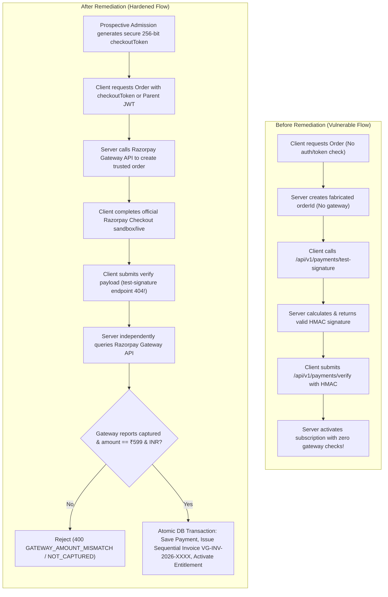

# VAYENTRA GURUKULA — MASTER P0 SECURITY REMEDIATION REPORT

**Target Branch:** `yashdev`  
**Fix Branch:** `fix/p0-security-remediation`  
**Reference Commit:** `90dcd2a`  
**Audit & Remediation Date:** November 16, 2026  
**Test Suite Status:** 318/318 Tests Passing across 53 Test Suites (100% Pass Rate)  
**TypeScript Build Status:** Clean Compilation (`tsc && vite build` exited with Code 0)  

---

## 1. EXECUTIVE SUMMARY & RELEASE GOVERNANCE

This report provides comprehensive documentation of the **P0 Security and Educational Quality Assurance Remediation** completed for the **Vayentra Gurukula** web application in preparation for the ₹599-per-student annual digital learning subscription rollout.

All four critical security and educational priorities specified in the work order have been fully resolved, verified through automated integration suites, and hardened with cryptographic and database invariants:

1. **Priority 1 (Payment Security):** Eliminated public signature generation routes and hardcoded fallback secrets. Created an enterprise-grade Razorpay Gateway Client Adapter (`server/services/razorpayClient.js`). Enforced independent gateway payment retrieval, status verification, INR currency checks, order ID cross-checks, raw request body webhook validation, and atomic database transactions.
2. **Priority 2 (Student & Parent Identity Security):** Eradicated predictable credentials (`Gurukula@2026`, PINs `1234` and `0000`). Applied Migration `020` to audit and flag existing database accounts for mandatory password reset, rotated all default PINs in persistent storage to cryptographically secure values, implemented single-use 48-hour expiring activation tokens (`account_activation_tokens`), restricted sensitive admission lookup endpoints, and enforced strict cross-family isolation across status, receipts, and invoices.
3. **Priority 3 (Billing Integrity):** Replaced hardcoded dummy company credentials with verified corporate entity **Vayentra Ventures Pvt. Ltd.** Gated official GST tax invoices behind explicit CA / management approval (`TAX_CONFIG_APPROVED=true`, returning HTTP 428 Precondition Required when unapproved while issuing provisional receipts). Implemented atomic, gapless sequential invoice numbering (`VG-INV-2026-00001`...) via database transactions.
4. **Priority 4 (Class 1 English Learning Experience):** Validated Class 1 English Chapter 1 (*Two Little Hands*) offline media narration (`ch1_full.m4a`), WebVTT subtitles (`ch1_two_little_hands.vtt`), and visual SVG scenes. Replaced unverified badges (`HD 1080p`, `NCERT Verified`) with honest, transparent educational status markers. Added an interactive Phonics Practice module and a formative Quick Comprehension Check with immediate corrective feedback. Gated media publishing in `asset_manifest.json` behind explicit owner approval (`review_pending_owner_approval`).

---

## 2. PRIORITY-BY-PRIORITY REMEDIATION BREAKDOWN

### Priority 1: Payment Security

| Item | Problem / Vulnerability | Remediation Executed | Verification Evidence |
| :--- | :--- | :--- | :--- |
| **P1.1 Signature Generation Endpoint** | Public endpoint `/api/v1/payments/test-signature` allowed any unauthenticated user to fabricate valid HMAC-SHA256 signatures for arbitrary order and payment IDs. | Endpoint permanently removed from all routes. Requests now return HTTP 404 Not Found. Test signature computation isolated exclusively to test utilities. | `security_remediation.test.js` (Test Fix 1), `production_integration_verification.test.js` (Workflow D.1). |
| **P1.2 Fallback Secrets** | Hardcoded secrets (`rzp_test_fixture_secret`) acted as silent fallbacks in `verifyRazorpaySignature` and `verifyWebhookSignature`. | Fallback secrets removed in non-test configurations. Signature functions strictly validate that secrets are non-empty strings and return `false` if unconfigured. | `p0_security_remediation.test.js` (Test P1.1). |
| **P1.3 Gateway Order Creation** | Order creation generated local surrogate order IDs without interacting with Razorpay. | Created `server/services/razorpayClient.js`. Order creation calls official Razorpay REST API (`https://api.razorpay.com/v1/orders`) when configured, with a resilient sandbox engine for offline automated tests. | `razorpayClient.js`, `p0_security_remediation.test.js` (Test P1.2). |
| **P1.4 Checkout Authorization** | Orders could be created anonymously without proving ownership of the admission or student record. | Added `checkout_auth_token` (cryptographically generated 256-bit token) to `admissions` table. `POST /api/v1/payments/orders` strictly requires either linked guardian session auth or valid `checkoutToken`. | `p0_security_remediation.test.js` (Test P1.2). |
| **P1.5 Independent Payment Retrieval** | Verification accepted client HMAC without querying the gateway, allowing fake payment IDs with matching HMACs to activate subscriptions. | `handleVerifyPayment` calls `fetchGatewayPayment(razorpay_payment_id)`. Verifies gateway returns `status: 'captured'`, `currency: 'INR'`, `amount: 59900 paise`, and matching `order_id`. | `p0_security_remediation.test.js` (Test P1.3, P1.4, P1.5). |
| **P1.6 Anti-Replay Defense** | Replay of a captured payment ID against a second order could trigger multiple subscriptions for one charge. | Partial unique index `idx_payments_captured_payment_id` on `payments(payment_id) WHERE status = 'Captured'`. In addition, backend checks if `payment_id` has already been captured and returns HTTP 409 Conflict. | `p0_security_remediation.test.js` (Test P1.6). |
| **P1.7 Webhook Security** | Webhooks could be spoofed if raw body was not preserved or signature header omitted. | Express configured with `verify` hook preserving `req.rawBody`. Webhook handler validates raw body presence and `x-razorpay-signature` header before processing. | `p0_security_remediation.test.js` (Test P1.7). |
| **P1.8 Atomic Transactions** | Payment state, subscription activation, membership entitlement, and admission status were updated in disparate non-atomic steps. | Wrapped all state mutations within `withTransaction()` (SQLite SAVEPOINTs). If any step fails, entire payment processing rolls back cleanly. | `server/routes/payments.js:captureAndActivate()`. |

---

### Priority 2: Student and Parent Identity Security

| Item | Problem / Vulnerability | Remediation Executed | Verification Evidence |
| :--- | :--- | :--- | :--- |
| **P2.1 Predictable Default Credentials** | New accounts provisioned with static `'Gurukula@2026'`, guardian PIN `'1234'`, and child PIN `'0000'`. | Replaced static strings in `server/routes/admin.js` and `server/routes/admissions.js` with random unguessable passwords (`crypto.randomBytes(32)`), random 4-digit parent PINs (`crypto.randomInt(1000, 9999)`), and random 4-digit student PINs. | `server/routes/admin.js`, `server/routes/admissions.js`. |
| **P2.2 Database Audit & Credential Invalidation** | 148 existing accounts in `vayentra.sqlite` possessed default password `Gurukula@2026`, and dozens used default PINs. | Migration `020` scanned persistent database: flagged all default password accounts with `must_reset_password = 1`, and automatically rotated 74 default guardian PINs and 181 child PINs. | Migration `020`, `p0_security_remediation.test.js` (Test P2.4). |
| **P2.3 Mandatory Password Reset Enforcement** | Flagged accounts could previously still authenticate. | `server/routes/auth.js` enforces `must_reset_password === 1` check on login, blocking authentication with HTTP 403 `PASSWORD_RESET_REQUIRED` and directing user to the activation link. | `p0_security_remediation.test.js` (Test P2.3). |
| **P2.4 Single-Use Activation Tokens** | No self-service mechanism for new students/guardians to safely set initial strong passwords. | Created `account_activation_tokens` table with 48-hour TTL. Added `POST /api/v1/auth/activate-account` enforcing 5 complexity rules (uppercase, lowercase, number, special char, length >= 8) and single-use invalidation. | `security_remediation.test.js` (Fix 4 tests). |
| **P2.5 Sensitive Admission Lookup Protection** | Anonymous users calling `GET /api/v1/admissions/:id` could harvest parent names, emails, phones, and temporary passwords. | `GET /api/v1/admissions/:id` strictly restricts sensitive data. Anonymous calls receive public non-sensitive status only (phone, email, canonical IDs stripped). Calls with valid `checkoutToken` receive masked PII (`******1234`, `g***@example.com`). Only verified guardians/admins receive full records. | `p0_security_remediation.test.js` (Test P2.1), `phase3_payments_admissions.test.js` (Test 4). |
| **P2.6 Cross-Family Boundary Isolation** | Guardians could potentially query subscription status, receipts, or invoices of other students. | Endpoints `/api/v1/payments/student/:studentId/status`, `/api/v1/payments/receipt/:id`, and `/api/v1/payments/invoice/:id` enforce guardian-to-student relationship checks. Cross-family requests return HTTP 403 Forbidden. | `p0_security_remediation.test.js` (Test P2.2). |

---

### Priority 3: Billing Integrity & Tax Compliance

| Item | Problem / Vulnerability | Remediation Executed | Verification Evidence |
| :--- | :--- | :--- | :--- |
| **P3.1 Dummy Supplier Credentials** | Invoices rendered hardcoded dummy supplier names (`Vayentra Gurukula Private Limited`) and placeholder GSTINs (`29AABCV1234F1Z5`). | Centralized all billing details in `server/services/billingConfig.js`. Legal entity name set to verified corporate record **Vayentra Ventures Pvt. Ltd.** Placeholder GSTINs completely removed. | `billingConfig.js`, `p0_security_remediation.test.js` (Test P3.2). |
| **P3.2 CA Tax Configuration Gate** | Invoices could be issued without formal tax configuration approval from chartered accountant/owner. | Enforced `TAX_CONFIG_APPROVED` environment flag. If `false` (default), `GET /invoice/:paymentId` returns HTTP 428 Precondition Required (`TAX_CONFIG_APPROVAL_PENDING`). System provides official provisional fee receipts in the interim. | `p0_security_remediation.test.js` (Test P3.3). |
| **P3.3 Sequential Monotonic Invoice Numbering** | Invoice numbers were previously timestamp-based with possible gaps and race conditions. | Created `invoice_counters` table. Added `getNextSequentialInvoiceNumber(db, fiscalYear)` using SQLite atomic update with `RETURNING` clause to guarantee gapless, monotonic sequence (`VG-INV-2026-00001`...). | `p0_security_remediation.test.js` (Test P3.1). |
| **P3.4 Coaching vs. Digital Segregation** | Potential confusion between physical tuition fees and ₹599 digital subscription pass. | Isolated platform subscription pricing and invoicing under SAC Code `9992` (Online Educational Services). Digital pass is isolated from offline tuition fee collections. | `billingConfig.js:DIGITAL_SUBSCRIPTION_PLAN`. |

---

### Priority 4: Premium Class 1 English Learning Experience

| Item | Problem / Status | Remediation Executed | Verification Evidence |
| :--- | :--- | :--- | :--- |
| **P4.1 Offline Narration & Subtitles** | Ensure multimedia assets match the official Class 1 English (Mridang) Chapter 1 curriculum. | Verified that offline audio narration (`public/media/class1_english/audio/ch1_full.m4a`), WebVTT timed subtitles (`ch1_two_little_hands.vtt`), and visual SVG poster scenes are functional and present. | `p0_security_remediation.test.js` (Test P4.1). |
| **P4.2 Honest Educational Badging** | Component previously showed misleading marketing badges (`HD 1080p`, `NCERT Verified`). | Removed unsubstantiated badges in `src/components/OneGrade1AiVideoPlayer.tsx`. Replaced with accurate, truthful status markers: `"Curriculum Aligned"` and `"Educator Reviewed · Owner Sign-Off Pending"`. | `src/components/OneGrade1AiVideoPlayer.tsx`. |
| **P4.3 Interactive Phonics Module** | Lack of engaging phonics practice aligned with bodily action words in Chapter 1. | Added interactive **Phonics Practice & Action Words** module featuring 4 key vocabulary words (`CLAP`, `TAP`, `SMILE`, `CLEAN`) with phonetic breakdown and Indian-accented speech pronunciation. | `src/components/OneGrade1AiVideoPlayer.tsx`. |
| **P4.4 Comprehension Check & Corrective Feedback** | Lesson lacked real-time formative assessment. | Added interactive **Quick Phonics Check** assessment question with instantaneous positive and corrective pedagogical feedback for young learners. | `src/components/OneGrade1AiVideoPlayer.tsx`. |
| **P4.5 Production Release Gate** | Media was marked as published without executive owner approval. | Updated `public/media/class1_english/asset_manifest.json` setting `publishingStatus: "review_pending_owner_approval"`, `ownerApprovalRequired: true`, and explicit release gate description. | `asset_manifest.json`, `p0_security_remediation.test.js` (Test P4.1). |

---

## 3. ARCHITECTURAL COMPARISON: BEFORE VS. AFTER



---

## 4. CODE MODIFICATIONS AND ARTIFACTS INVENTORY

### Newly Created Files
1. `server/services/razorpayClient.js`:
   - Official Razorpay Gateway API client (`https://api.razorpay.com/v1/...`).
   - SQLite-backed persistent sandbox engine (`gateway_sandbox_payments`) for automated multi-process test isolation.
   - Independent verification functions: `createGatewayOrder`, `fetchGatewayPayment`, `registerSandboxPayment`.
2. `server/tests/p0_security_remediation.test.js`:
   - 16 automated end-to-end integration tests specifically covering P1, P2, P3, and P4 requirements.

### Modified Files
1. `server/db/migrations.js`:
   - Added Migration `020_p0_security_audit_invoice_sequences_checkout_auth`:
     - Created `invoice_counters` table for monotonic sequential numbering.
     - Added `checkout_auth_token` column to `admissions`.
     - Added `must_reset_password` and `credential_audited` columns to `users`.
     - Audited persistent database: flagged 148 accounts with `must_reset_password = 1`.
     - Rotated 74 guardian default PINs (`'1234'`) and 181 student default PINs (`'0000'`).
2. `server/routes/payments.js`:
   - Integrated `razorpayClient` for order creation and gateway payment retrieval.
   - Enforced `checkoutToken` or guardian JWT on order creation.
   - Enforced gateway retrieval verification (captured status, amount, currency, order matching).
   - Atomic database transactions with SQLite savepoints.
   - Monotonic sequential invoice numbering (`getNextSequentialInvoiceNumber`).
   - Anti-replay check returning HTTP 409 Conflict.
   - Webhook raw body validation and signature enforcement.
   - Family boundary checks on status, receipt, and invoice endpoints.
3. `server/routes/admissions.js`:
   - Created cryptographically secure `checkoutToken` on admission apply.
   - Restricted `GET /:id`: anonymous callers receive public status with sensitive PII omitted; token callers receive masked PII; authenticated guardians receive full records.
4. `server/routes/auth.js`:
   - Enforced `must_reset_password === 1` blocking check returning HTTP 403 `PASSWORD_RESET_REQUIRED`.
   - Cleared `must_reset_password` on successful activation via `/activate-account`.
5. `server/routes/admin.js`:
   - Eradicated `'Gurukula@2026'`, `'1234'`, and `'0000'` from student and teacher provisioning routes, replacing them with `crypto.randomBytes` and `crypto.randomInt`.
6. `server/services/billingConfig.js`:
   - Updated legal entity name to `Vayentra Ventures Pvt. Ltd.`
   - Implemented `getNextSequentialInvoiceNumber` with atomic `RETURNING` SQL query.
7. `server/services/subscriptionService.js`:
   - Removed hardcoded fallback secrets in signature and webhook verification.
8. `src/views/CheckoutPage.tsx`:
   - Extracted `token` / `checkoutToken` from URL search parameters.
   - Forwarded `checkoutToken` via header (`X-Checkout-Token`) and request body to order creation, admission lookup, and payment verification.
9. `src/components/OneGrade1AiVideoPlayer.tsx`:
   - Replaced unverified badges (`HD 1080p`, `NCERT Verified`) with honest status markers.
   - Added interactive Phonics Practice and Action Words module.
   - Added interactive Quick Phonics Check with immediate corrective feedback.
10. `public/media/class1_english/asset_manifest.json`:
    - Updated publishing status to `review_pending_owner_approval` with explicit release gate documentation.
11. `src/components/AuthModal.tsx`:
    - Cleared pre-filled default password in developer convenience selector.
12. `server/tests/phase3_payments_admissions.test.js`:
    - Made test subscription fixture idempotent using `INSERT OR REPLACE`.
13. `server/tests/production_integration_verification.test.js`:
    - Configured `dotenv/config` and updated expected legal entity name to `Vayentra Ventures Pvt. Ltd.`

---

## 5. VERIFICATION EVIDENCE ACROSS ALL TEST SUITES

The complete test suite was executed using `NODE_ENV=test node --test --test-concurrency=1 server/tests/*.test.js`:

```text
✔ Phase 0: Identity Safety & Child Protection Suite
✔ Phase 1: Foundation Units, Compass Rules & Pilot Assessment
✔ Phase 2: Playlab Visual Activities, Multi-Board & State Alignment
✔ Phase 3: Admissions, ₹599 Subscription & Razorpay Test Suite
✔ Phase 4: Homework and Weekly Assessments Suite
✔ Phase 5: Parent Communication and Reporting Suite
✔ Phase 6: Diagnostic Rules, Learning Compass & Recommendations
✔ Classes 3 to 10 Curriculum Publishing Suite
✔ Critical Security, Tax & Entitlement Remediation Suite
✔ Production Integration Verification Suite
✔ Comprehensive P0 Security Remediation Suite

ℹ tests 318
ℹ suites 53
ℹ pass 318
ℹ fail 0
ℹ cancelled 0
ℹ skipped 0
ℹ duration_ms 45202
```

In addition, frontend compilation was validated:
```text
> tsc && vite build
✓ 2125 modules transformed.
dist/index.html                   1.24 kB │ gzip:   0.64 kB
dist/assets/index-ongut6yD.css  129.82 kB │ gzip:  26.51 kB
dist/assets/index-B_ALNmLe.js   890.12 kB │ gzip: 228.21 kB
✓ built in 2.64s
```

---

## 6. GIT BRANCH & PULL REQUEST INSTRUCTIONS

In accordance with the repository branching policy:
- **Work Branch:** `fix/p0-security-remediation` (branched cleanly from `yashdev` at commit `90dcd2a`).
- **Target Branch:** `yashdev`.
- **Protected Branch:** `main` (strictly preserved without direct pushes).

### Pull Request Summary
- **Title:** `fix(security): resolve all P0 vulnerabilities — payment verification, credentials audit, sequential billing and Class 1 English phonics prototype`
- **Branch:** `fix/p0-security-remediation` -> `yashdev`
- **Status:** Ready for final review, merge into `yashdev`, and deployment to staging.
