# Vayentra Learning Platform: Developer Design Diagrams

Classes 1 to 10, CBSE / ICSE / Karnataka State. Each diagram maps to a requirement group. Diagrams are proposals for implementation, not built software.

[1 Architecture](#d1)[2 Roles](#d2)[3 Auth](#d3)[4 Consent](#d4)[5 Curriculum DB](#d5)[6 Assessment DB](#d6)[7 Commerce DB](#d7)[8 Content workflow](#d8)[9 Student flow](#d9)[10 Mastery](#d10)[11 Assignments](#d11)[12 Fees](#d12)[13 Subscription](#d13)[14 Notifications](#d14)[15 AI tutor](#d15)[16 Teacher](#d16)[17 Parent](#d17)[18 Admin](#d18)[19 Deployment](#d19)[20 Attendance](#d20)[21 Bulk import](#d21)[22 Tickets](#d22)[23 Staff roles](#d23)[24 Year rollover](#d24)[25 Concept map](#d25)[26 Mistake notebook](#d26)[27 Safeguarding](#d27)[28 Teacher analytics](#d28)[29 Parent engagement](#d29)[30 Admissions funnel](#d30)[31 Gamification](#d31)[32 Learning tools](#d32)[33 Language + voice](#d33)[34 Trust + quality](#d34)[35 Offline](#d35)[36 Flags + release](#d36)[37 Finance + legal](#d37)[38 Class 1-4](#d38)[39 Partners + add-ons](#d39)[40 Context v1.1](#d40)[41 Learning path](#d41)[42 Daily plan](#d42)[43 Live class](#d43)[44 Mentor](#d44)[45 Doubts](#d45)[46 Practice](#d46)[47 Revision](#d47)[48 Video player](#d48)[49 Search](#d49)[50 Onboarding](#d50)[51 Shared device](#d51)[52 Feedback](#d52)[53 Scholarship](#d53)[54 Reports](#d54)[55 Notif centre](#d55)[56 Subscription](#d56)[57 Settings](#d57)[58 Authoring UI](#d58)[59 App roadmap](#d59)[60 Analytics](#d60)[61 Route map](#d61)[62 Guards](#d62)[63 API routers](#d63)[64 Responsive](#d64)[65 Device tiers](#d65)[66 UI states](#d66)[67 Guardians](#d67)[68 Finance + tracker](#d68)[69 Consent](#d69)[70 Security](#d70)[71 Secrets](#d71)[72 AI governance](#d72)[73 Money](#d73)[74 Chargeback](#d74)[75 Inbound msgs](#d75)[76 Msg caps](#d76)[77 Appeals](#d77)[78 Accommodations](#d78)[79 Calendar](#d79)[80 Allocation](#d80)[81 Translation](#d81)[82 Asset library](#d82)[83 Voice rights](#d83)[84 Delivery](#d84)[85 Incidents](#d85)[86 SEO + links](#d86)[87 Release news](#d87)[88 Kiosk](#d88)[89 Support KB](#d89)[90 Pricing](#d90)[91 Answer sheets](#d91)[92 Teacher ops](#d92)[93 Experiments](#d93)[94 Exam season](#d94)[95 Data quality](#d95)[96 Partners](#d96)[97 Certificates](#d97)[98 Tech Academy](#d98)[99 Academy data](#d99)[100 Referral](#d100)

## 1. System architecture (common platform, technical NFRs)

Single modular backend, queue workers for AI and messaging, CDN for video.

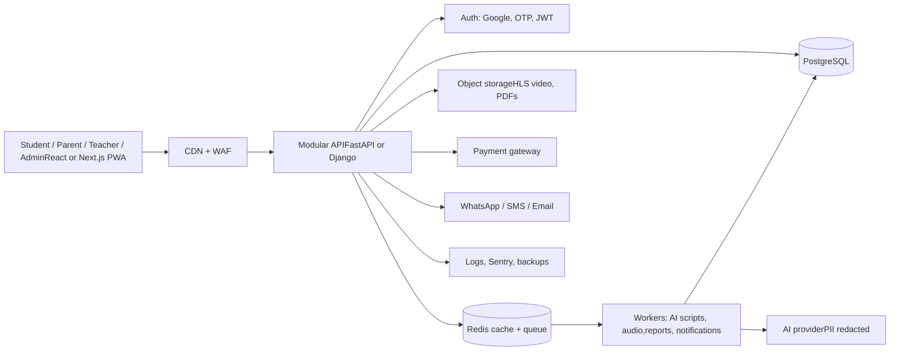

## 2. Roles and permissions

Server-side RBAC. Scope is enforced by family, class or tenant ID, never client-supplied.

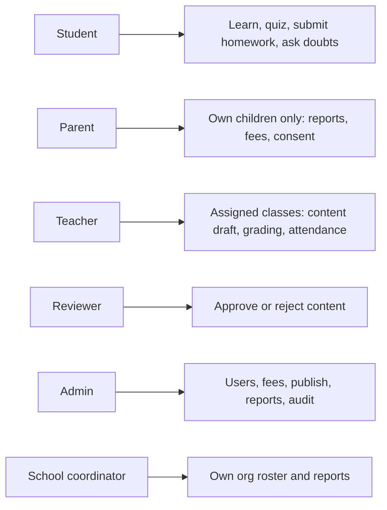

## 3. Authentication: Google, OTP, child profile

Parent signs in with Google or OTP. Children use a profile and PIN under the parent account.

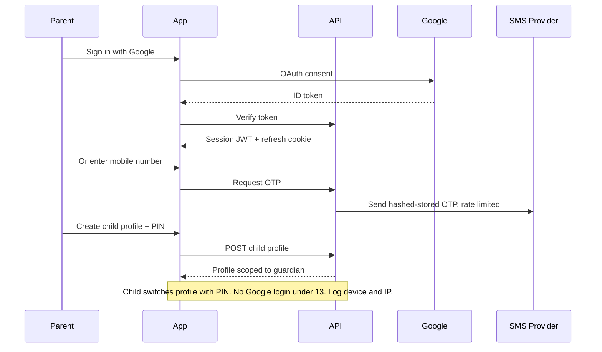

## 4. Guardian consent (DPDP, child safety)

No child data processing until consent is recorded.

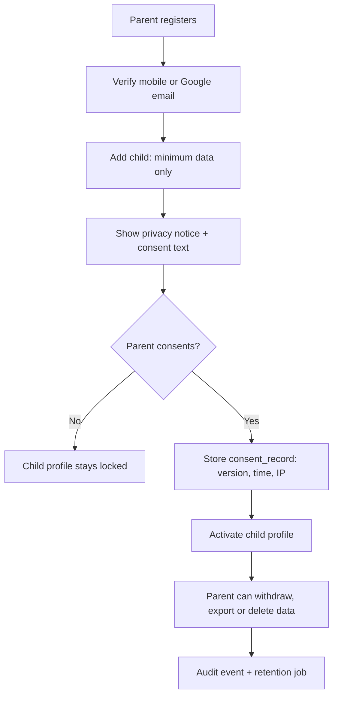

## 5. Data model: curriculum and users (Class 1 to 10, 3 boards)

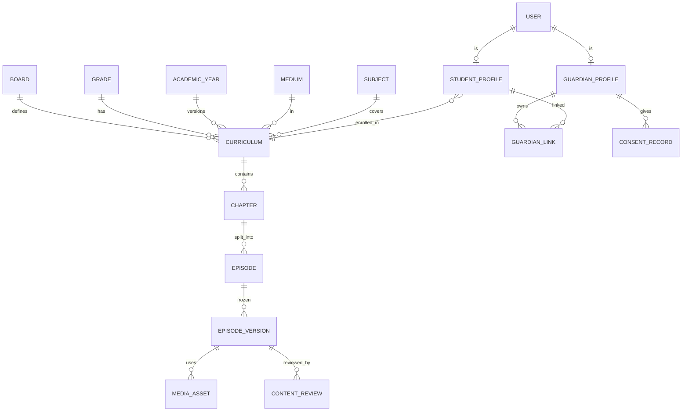

## 6. Data model: assessment, assignments, mastery

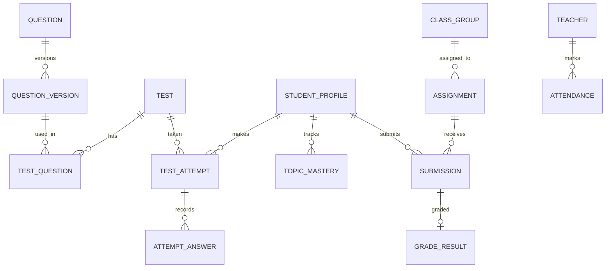

## 7. Data model: fees, subscriptions, notifications

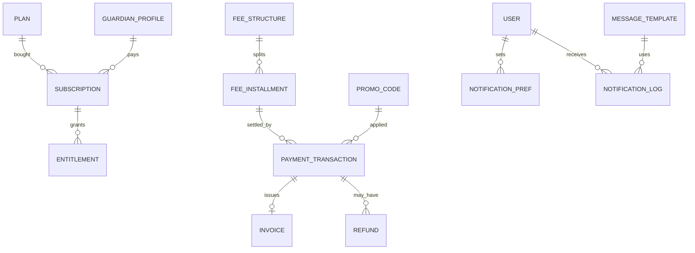

## 8. Content creation and publishing workflow

AI draft can never go public without reviewer approval (AT-08).

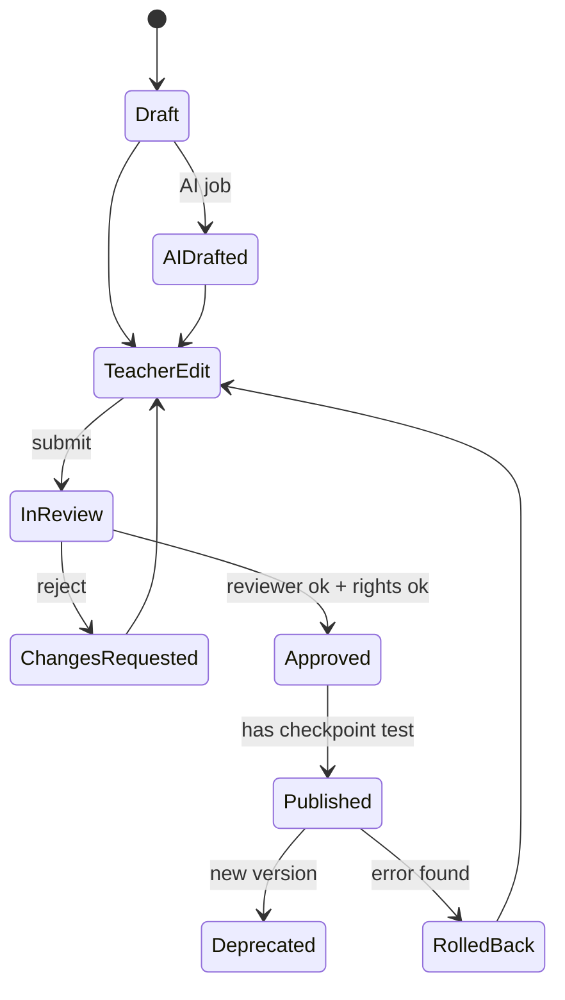

## 9. Student learning journey (episode-first)

For Class 1 to 4: audio-first, short episodes, picture questions, parent-assisted mode.

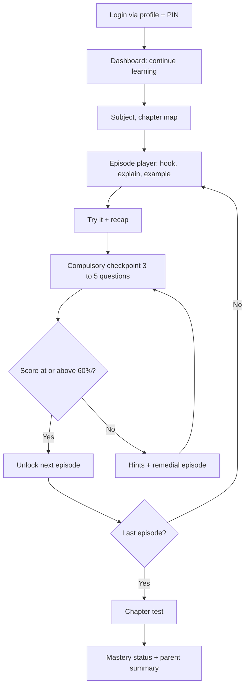

## 10. Assessment scoring and mastery engine

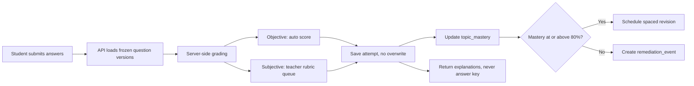

## 11. Homework and assignment lifecycle

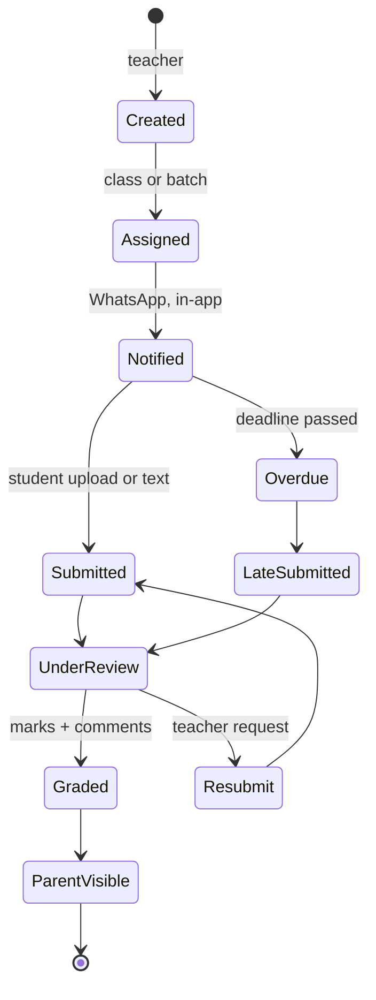

## 12. Fee payment and reconciliation

Frontend return is not proof of payment. Only a signed, idempotent webhook activates access.

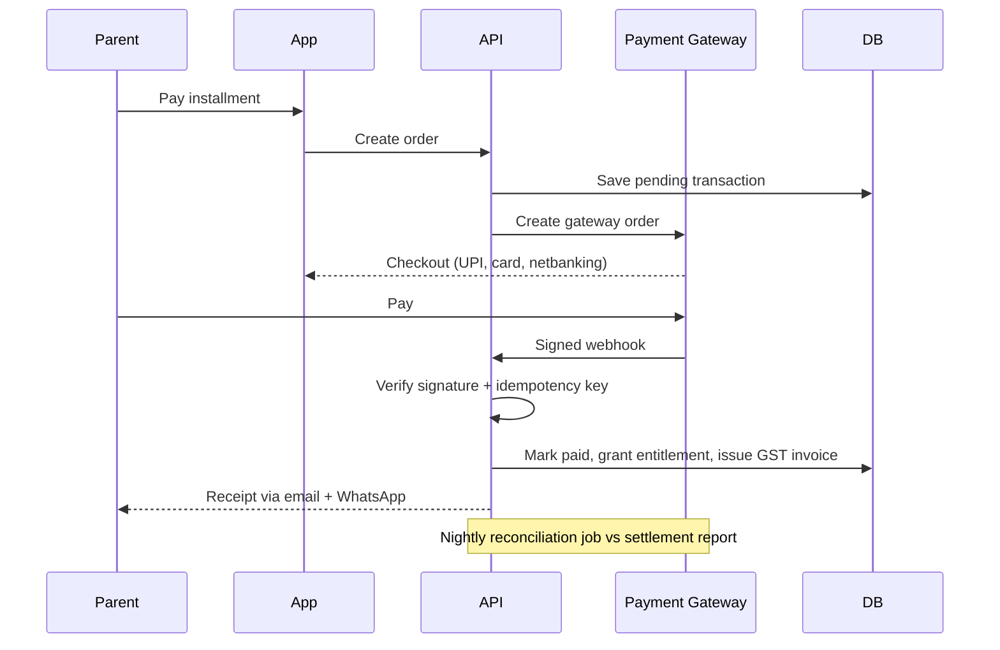

## 13. Subscription and entitlement states

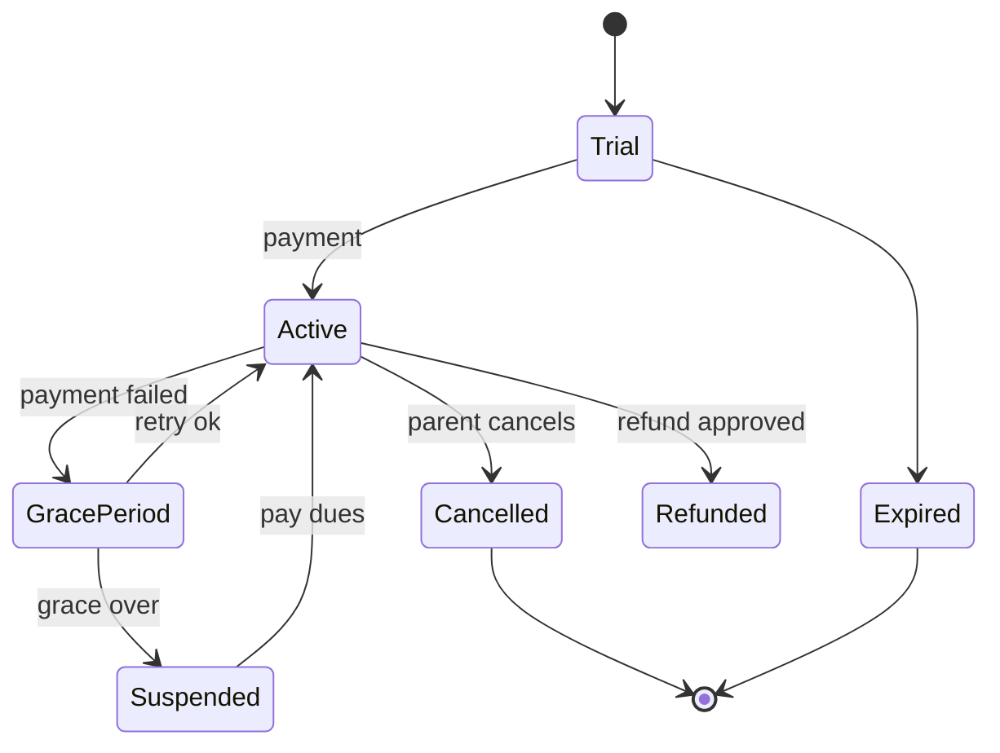

## 14. WhatsApp, SMS and email notifications

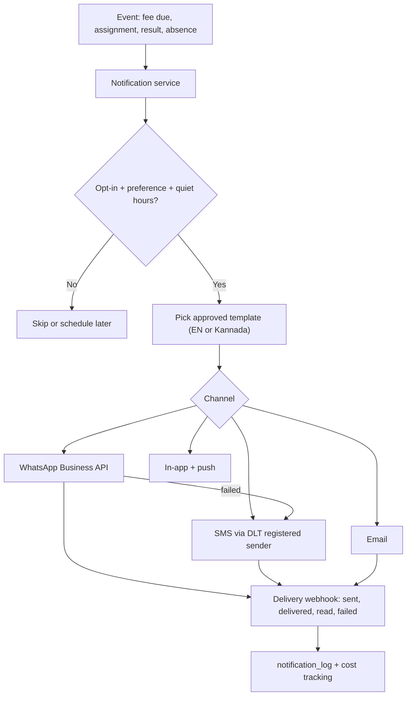

## 15. AI doubt tutor with child-safety guardrails

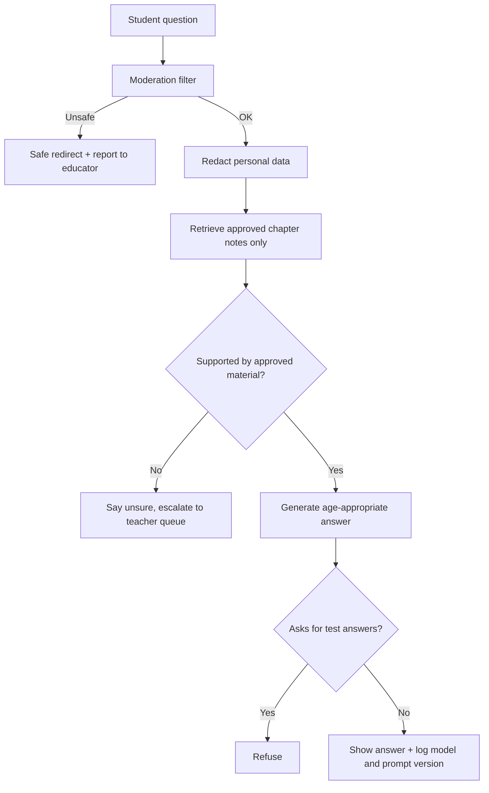

## 16. Teacher / faculty module

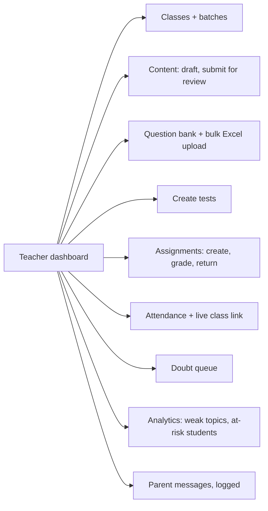

## 17. Parent module

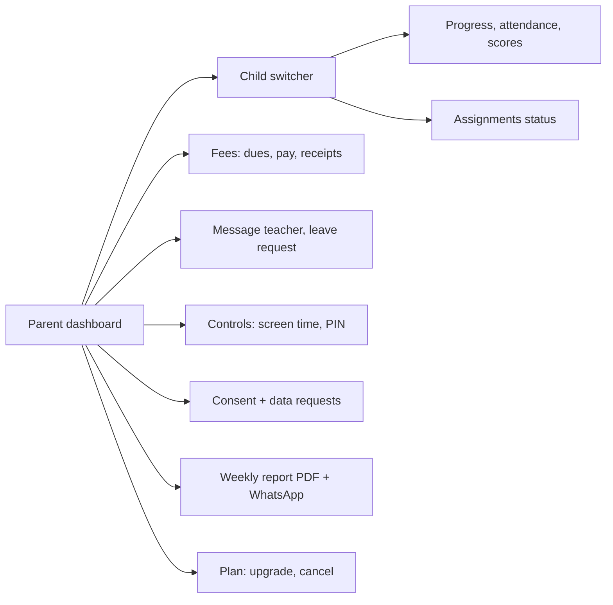

## 18. Admin module map

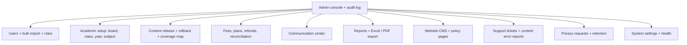

## 19. Deployment, CI/CD and operations

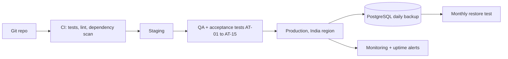

## 20. Attendance and live classes

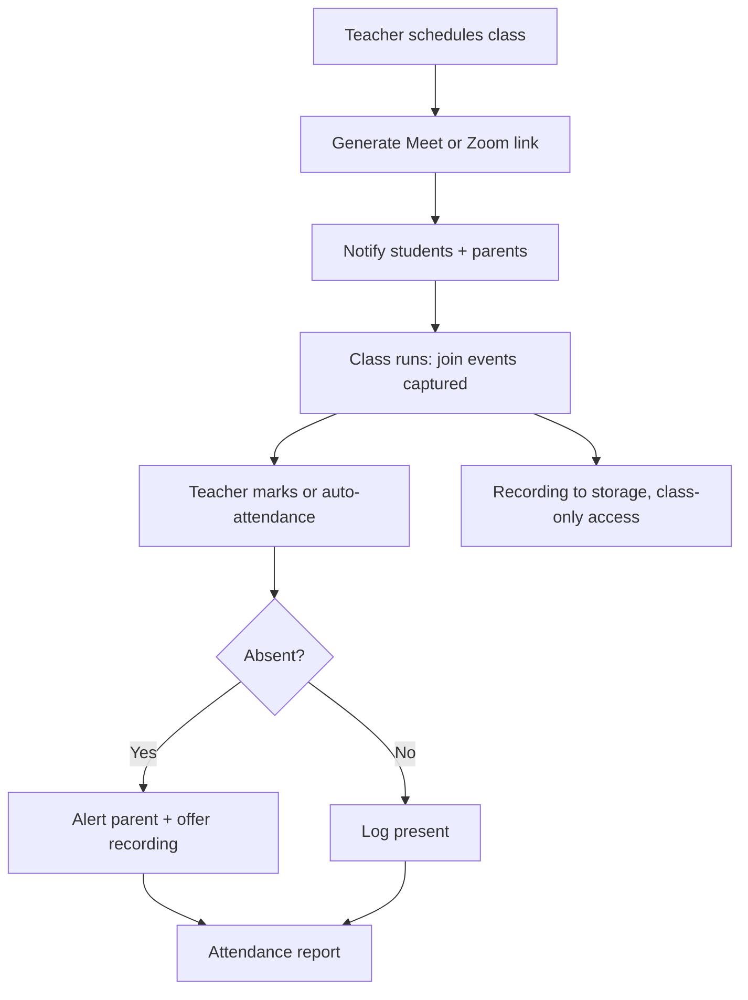

## 21. Bulk import (students, parents, teachers, questions)

```mermaid
flowchart LR
A["Download template"] --> B["Upload CSV or Excel"]
B --> C["Validate: format, duplicates, class exists"]
C --> D{"Errors?"}
D -- Yes --> E["Row-level error report"]
E --> B
D -- No --> F["Preview"]
F --> G["Admin confirms"]
G --> H["Queue job inserts in one transaction"]
H --> I["Invite parents by SMS or WhatsApp + audit log"]
```

## 22. Support ticket lifecycle

```mermaid
stateDiagram-v2
[*] --> New
New --> Assigned: auto-route by category
Assigned --> InProgress
InProgress --> WaitingUser
WaitingUser --> InProgress
InProgress --> Escalated: SLA breach
Escalated --> InProgress
InProgress --> Resolved
Resolved --> Closed: CSAT rating
Resolved --> InProgress: reopened
Closed --> [*]
```

## 23. Extended staff roles

```mermaid
flowchart LR
SA["Super admin"] --> P0["Everything + role management"]
AC["Accountant"] --> P1["Fees, refunds, GST, exports"]
SU["Support agent"] --> P2["Tickets, view-as-user with reason"]
CO["Counsellor"] --> P3["Career guidance, student concerns"]
MK["Marketing"] --> P4["CMS, leads, coupons"]
CP["Content producer"] --> P5["Media upload, no publish"]
SG["Safeguarding officer"] --> P6["Concern cases only"]
```

## 24. Year-end rollover, board and medium change

```mermaid
flowchart TB
A["Academic year closing"] --> B["Snapshot results + archive"]
B --> C["Clone curriculum version"]
C --> D["Diff vs new official syllabus"]
D --> E["Editors review changed chapters"]
E --> F["Promote students to next grade"]
F --> G["Re-map enrolment to new curriculum version"]
G --> H["Parent confirms renewal"]
X["Board or medium change request"] --> Y["Map via concept IDs"]
Y --> Z["Reviewer approves credit"]
Z --> G
```

## 25. Diagnostic test, concept map and prerequisite gap-fill

```mermaid
flowchart TB
A["New student signup"] --> B["Diagnostic test per subject"]
B --> C["Score per concept ID"]
C --> D["Concept graph with prerequisites"]
D --> E{"Prerequisite weak?"}
E -- Yes --> F["Insert earlier-class refresher episodes"]
E -- No --> G["Start at grade chapter"]
F --> H["Personal learning path"]
G --> H
H --> I["Concept map: locked, learning, mastered"]
H --> J["2-minute prior-knowledge check before each chapter"]
```

## 26. Mistake notebook, find-your-error coach, explain-it-back

```mermaid
flowchart LR
A["Wrong answer saved"] --> B["Tag: slip, concept gap, misread"]
B --> C["Mistake notebook"]
C --> D["Find-your-error coach"]
D --> E["Retry similar question"]
E --> F{"Correct?"}
F -- Yes --> G["Mark fixed + spaced recheck"]
F -- No --> H["Suggest remedial episode"]
B --> I["Pattern report to parent"]
J["Explain it back: voice or text"] --> K["Teacher or AI feedback vs rubric"]
K --> C
```

## 27. Safeguarding concern workflow

Legal escalation duties must be confirmed with counsel.

```mermaid
flowchart TB
A["Report a concern button"] --> B["Case created, restricted access"]
B --> C["Safeguarding officer triage within 24h"]
C --> D{"Severity"}
D -- High --> E["Suspend access + escalate per law"]
D -- Medium --> F["Investigate + contact parent"]
D -- Low --> G["Counsel, warn, note"]
E --> H["Audit log + incident report"]
F --> H
G --> H
H --> I["Closure + policy review"]
```

## 28. Teacher analytics: heatmap, grouping, remedial pack

```mermaid
flowchart LR
A["Attempt data"] --> B["Class x concept mastery matrix"]
B --> C["Heatmap"]
C --> D["Auto-group by shared misconception"]
D --> E["One-click remedial pack: worksheet + recap + 5Q retest"]
E --> F["Assign + notify"]
B --> G["Question difficulty calibration + flag bad keys"]
B --> H["Parent meeting prep sheet"]
```

## 29. Parent engagement and wellbeing signals

```mermaid
flowchart TB
D["Weekly job"] --> A["Parent coach card, Kannada or English"]
D --> B["Smart schedule from school, tuition, sleep hours"]
D --> C["Rules: inactivity, late-night use, rapid wrong answers"]
C --> E["Gentle prompt only, no diagnosis"]
A --> H["Send via WhatsApp + app"]
F["Trusted adult invite"] --> G["Read-only access with expiry"]
I["Meeting booking + NPS survey"] --> H
```

## 30. Lead-to-admission funnel (CRM, demo, referral, chatbot)

```mermaid
flowchart LR
A["Landing page or ad"] --> B["Lead form + WhatsApp bot"]
B --> C["CRM lead"]
C --> D["Demo class booking, trial limit per phone"]
D --> E["Follow-up reminders"]
E --> F{"Converts?"}
F -- Yes --> G["Plan + payment + referral coupon"]
F -- No --> H["Nurture messages, opt-out honoured"]
G --> I["Conversion analytics"]
```

## 31. Safe gamification, streaks and exam countdown

```mermaid
flowchart TB
A["Effort events: episode, revision, fixed mistake"] --> B["Points + badges"]
A --> C["Streak with shield on quick revision"]
B --> D["Mastery map regions unlock"]
E["Exam date set"] --> F["Countdown pack: plan + mocks + weekly readiness note"]
G["Improvement vs own history"] --> H["Top improver scholarship"]
D --> I["Private to child and parent, no public leaderboard"]
```

## 32. Learning tools around the episode player

```mermaid
flowchart LR
P["Episode player"] --> L["3 levels: Simple, Standard, Challenge"]
P --> F["Formats: video, audio, illustrated text"]
P --> S["Interactive simulations"]
P --> M["Maths step checker"]
P --> G["Diagram label, drag-drop, map practice"]
P --> ST["Story mode, Classes 1 to 5"]
P --> K["Karnataka context examples, teacher verified"]
P --> W["Exam answer-writing trainer"]
P --> N["Notes, bookmarks, flashcards, mind maps"]
P --> HW["Handwritten maths photo, teacher review, OCR assist only"]
```

## 33. Language lab, voice and accessibility

```mermaid
flowchart TB
M["Student mic with parent consent"] --> A["Speech to text: Kannada, English, Hindi"]
A --> B["Pronunciation + fluency score"]
B --> C["Teacher samples and reviews"]
A --> D["Voice commands + voice doubts"]
M --> X["Audio auto-deleted after retention period"]
E["Accessibility settings"] --> F["Dyslexia font, read-aloud highlight, extra-time flag, data saver"]
```

## 34. Content trust, error reports and AI cost control

```mermaid
flowchart LR
A["Official syllabus source watcher"] --> B["Change detected"]
B --> C["Task for human editor"]
C --> D["Review + republish version"]
D --> E["Trust label: reviewer, board, year, date + AI disclosure"]
F["Student or parent reports error"] --> G["Triage"]
G --> D
G --> H["Thank-you badge"]
I["AI spend tracker"] --> J["Daily limits + cached approved answers"]
```

## 35. Low-bandwidth, prefetch and offline quiz queue

```mermaid
flowchart TB
A["App checks network"] --> B{"State"}
B -- Slow --> C["Lightweight mode: text + audio under 2 MB"]
B -- Offline --> D["Cached episodes + offline quiz queue"]
B -- Wi-Fi --> E["Prefetch next episode"]
D --> F["On reconnect: sync answers"]
F --> G["Server grades + resolves conflicts"]
```

## 36. Feature flags, view-as-user, releases and A/B tests

```mermaid
flowchart LR
A["Feature flag service"] --> B["By board, class, org, percentage"]
G["A/B tests"] --> A
C["Support agent: view as user"] --> D["Reason required + time limit + audit"]
E["Release pipeline"] --> F["Release notes + maintenance banner + rollback"]
```

## 37. Finance, terms versioning and copyright takedown

```mermaid
flowchart TB
C["Payment"] --> D["GST invoice, e-invoice if applicable"]
A["Refund approved"] --> B["Credit note"]
B --> E["Accounting export for Tally or Zoho"]
D --> E
F["Terms or policy update"] --> G["New version + forced re-accept"]
G --> H["terms_acceptance log"]
I["Copyright complaint"] --> J["Unpublish, log, notify, review"]
K["Content licence register"] --> J
```

## 38. Class 1 to 4 experience

```mermaid
flowchart TB
A["Primary profile"] --> B["Icon home + voice navigation"]
B --> C["Story-mode episode, 5 to 8 min, audio-first"]
C --> D["Picture or voice answer, drag and drop"]
D --> E["Stars, no scores shown to child"]
E --> F["Parent-assisted summary in Kannada or English"]
```

## 39. Partners, study buddy, mentors, add-ons, passport

```mermaid
flowchart LR
subgraph T["Partner tenancy"]
T1["org_id on every table"] --> T2["Partner portal"] --> T3["Revenue share report"]
end
subgraph B["Study buddy"]
B1["Teacher creates session"] --> B2["Two students join"] --> B3["Preset questions, reactions only, no free chat"]
end
subgraph M["Mentors"]
M1["Background check"] --> M2["Approved"] --> M3["Moderated session, parent visible"]
end
subgraph A["Add-ons and records"]
A1["Olympiad, holiday bridge, counselling"] --> A2["Entitlements"]
A3["Learning passport, shared on parent approval"]
end
```

## 40. System context v1.1 (new components)

Addendum v1.1: gaps G-01 to G-46.

```mermaid
flowchart LR
U["Student, Parent, Teacher, AdminPWA, later native apps"] --> API["API gateway + routers"]
API --> CORE["Core services: auth, learning, assessment, fees"]
CORE --> DB[("PostgreSQL")]
CORE --> Q["Queue + workers"]
API --> SRCH["Search index"]
API --> LIVE["Live class provider"]
API --> PUSH["Push + WhatsApp + SMS + email"]
API --> PAY["Payment gateway"]
Q --> AI["AI provider, PII redacted"]
CORE --> EV["Event collector, no PII"]
EV --> WH["Analytics store + dashboards"]
U --> RUM["Web vitals + error reports"]
RUM --> WH
```

## 41. Personalised learning path engine (FR-LRN-01, 03)

```mermaid
flowchart LR
A["Diagnostic scores"] --> P["Path builder"]
B["Topic mastery"] --> P
C["Syllabus order"] --> P
D["Exam date + time available"] --> P
P --> N["Next three steps"]
N --> W["Why this next: one sentence"]
N --> H["Student home"]
E["New attempt or mastery event"] --> P
```

## 42. Daily plan and weekly goals (FR-LRN-02, 04, 05)

```mermaid
flowchart TB
A["Parent or student sets minutes per day"] --> B["Plan builder mixes new episode, practice, revision"]
B --> C["Today list with time estimates"]
C --> D{"Done?"}
D -- Yes --> E["Progress to weekly goal"]
D -- No --> F["Roll over lightly, never shame"]
G["Exam date set"] --> B
E --> H["Parent summary"]
```

## 43. In-app live classroom (FR-LIVE)

```mermaid
sequenceDiagram
participant T as Teacher
participant S as Student
participant API as Vayentra API
participant LP as Live provider
T->>API: Schedule class
API-->>S: Reminder + calendar link
S->>API: Open live page
API->>API: Check entitlement and age rules
API->>LP: Create join token
S->>LP: Join, mic and camera off by default
S->>T: Raise hand or poll answer
T->>LP: Mute all, share board
LP-->>API: Join and leave events
API->>API: Mark attendance, teacher can correct
LP-->>API: Recording ready
API-->>S: Replay with chapter markers and question log
```

## 44. One-to-one mentor booking (FR-MENT)

```mermaid
sequenceDiagram
participant M as Mentor
participant P as Parent
participant API as API
M->>API: Publish slots
P->>API: View and pick slot
API->>P: Price and policy summary
P->>API: Pay
API-->>P: Confirmation + reminder
API-->>M: Booking
Note over P,M: Under 13: parent must be on the link. Session recorded.
M->>API: Notes + follow-up tasks
API-->>P: Summary
```

## 45. Doubts: text, voice, photo, video timestamp (FR-DBT)

```mermaid
flowchart TB
A["Ask: text, voice, photo, or from video time"] --> B["Moderation + redact personal data"]
B --> S["Suggest similar answered doubts"]
S --> C["Tutor tries using approved material only"]
C --> D{"Confident and supported?"}
D -- Yes --> E["Answer with steps + was it helpful?"]
D -- No --> F["Teacher queue with response-time promise"]
F --> G["Teacher answers: text, image, voice"]
E --> H["Status + notification"]
G --> H
H --> I["Photo deleted after retention period"]
```

## 46. Practice arena with adaptive difficulty (FR-PRC)

```mermaid
flowchart LR
A["Choose chapter or concept, or daily set"] --> B["Serve question at current level"]
B --> C{"Correct?"}
C -- Yes --> D["Raise level after streak"]
C -- No --> E["Step hint, no answer, then retry"]
E --> F["Lower level, save to Mistake Notebook"]
D --> B
F --> B
B --> G["Session summary"]
G --> H["Update mastery, not marks"]
```

## 47. Smart revision and flashcards (FR-REV)

```mermaid
flowchart TB
A["Mistakes + spaced-review due dates + key points"] --> B["Revision set builder"]
B --> C["Flashcards, formula sheet, summary PDF"]
C --> D["Student recall: know or review"]
D --> E["Update next review date"]
E --> A
F["Exam date"] --> G["Revision calendar"]
G --> B
```

## 48. Video player states (FR-VID)

```mermaid
stateDiagram-v2
[*] --> Loading
Loading --> Ready
Ready --> Playing
Playing --> Paused
Paused --> Playing
Playing --> Buffering: slow network
Buffering --> Playing
Playing --> InVideoQuestion: marker reached
InVideoQuestion --> Playing: answered or skipped
Playing --> AudioOnly: data saver or user
AudioOnly --> Playing
Playing --> OfflineNotice: connection lost
OfflineNotice --> Playing: reconnected
Playing --> Ended
Ended --> Checkpoint
Paused --> DoubtAtTime: ask doubt
DoubtAtTime --> Paused
```

## 49. Search, typed and voice (FR-SRCH)

```mermaid
flowchart LR
A["Typed or voice query"] --> B["Clean: spelling, Kannada, transliteration"]
B --> C["Filter by board, class, medium"]
C --> D["Approved content index only"]
D --> E["Rank: chapter, episode, concept, glossary"]
E --> F["Results with status: locked, new, mastered"]
A --> G["Log query without personal data"]
```

## 50. Onboarding flows (FR-ONB)

```mermaid
flowchart LR
subgraph P["Parent"]
P1["Account"] --> P2["Child + consent"] --> P3["Goals + language"] --> P4["Sample lesson"]
end
subgraph S["Student"]
S1["Pick avatar"] --> S2["Diagnostic"] --> S3["Skippable tour"] --> S4["First lesson"]
end
subgraph T["Teacher or admin"]
T1["Accept code of conduct"] --> T2["Role checklist"] --> T3["First task with sample data"]
end
```

## 51. Shared-device mode (FR-SHR)

```mermaid
stateDiagram-v2
[*] --> ParentMode
ParentMode --> ChooseChild
ChooseChild --> ChildMode: child PIN
ChildMode --> LockScreen: idle timeout
ChildMode --> LockScreen: daily limit reached
ChildMode --> ChooseChild: switch sibling
LockScreen --> ChildMode: child PIN, if time left
LockScreen --> ParentMode: parent PIN
ChildMode --> ParentMode: parent PIN only
Note right of ChildMode: No billing, settings or personal data
```

## 52. Feedback and quality loop (FR-FDB)

```mermaid
flowchart LR
A["Rate episode: two taps"] --> C["Aggregate per episode"]
B["Report an error"] --> C
C --> D{"Below threshold or error confirmed?"}
D -- Yes --> E["Editor task + reviewer"]
E --> F["New version, rollback if needed"]
F --> G["Thank-you badge to reporter"]
D -- No --> H["Teacher sees feedback"]
```

## 53. Scholarship and aptitude test funnel (FR-SCH)

```mermaid
flowchart LR
A["Landing page"] --> B["Register with parent consent"]
B --> C["Schedule slot"]
C --> D["Timed test, randomised, one attempt"]
D --> E["Score and band"]
E --> F["Scholarship rule set by admin"]
F --> G["Result page + counselling slot"]
G --> H{"Enrols?"}
H -- Yes --> I["Plan + payment"]
H -- No --> J["Consented follow-up only"]
```

## 54. Reports and optional benchmark (FR-RPT)

```mermaid
flowchart TB
A["Attempts, time on task, consistency"] --> B["Report builder"]
B --> C["Parent report: strengths, weak concepts, own-history trend"]
C --> D["PDF, WhatsApp, report card in English or Kannada"]
E["Parent opts in"] --> F{"Cohort large enough to be anonymous?"}
F -- Yes --> G["Anonymous band, parent only"]
F -- No --> H["Not shown"]
G --> C
B --> I["Teacher class report + export"]
```

## 55. Notification centre and digest (FR-NTC)

```mermaid
flowchart LR
A["Event"] --> B{"Preferences, quiet hours, consent"}
B -- Allowed --> C["Channel: WhatsApp, SMS, email, push"]
B -- Digest --> D["Daily or weekly digest"]
A --> E["In-app centre: grouped, unread count"]
E --> F["Tap: deep link to the right route"]
F --> G["Mark read"]
```

## 56. Subscription management (FR-SUB)

```mermaid
stateDiagram-v2
[*] --> Trial
Trial --> Active: pay
Active --> ChangePreview: upgrade or downgrade
ChangePreview --> Active: confirm, price and access shown
Active --> Paused: pause, progress kept
Paused --> Active: resume
Active --> CancelScheduled: cancel, access until period end
CancelScheduled --> Active: undo
CancelScheduled --> Ended
Ended --> Active: reactivate
```

## 57. Settings and privacy hub (FR-SET)

```mermaid
flowchart LR
S["Settings"] --> A["Profile"]
S --> B["Language: English, Kannada"]
S --> C["Accessibility: text size, motion, theme"]
S --> D["Notifications"]
S --> E["Privacy and consent"]
S --> F["Devices and sessions"]
S --> G["Export or delete data"]
S --> H["Help and support"]
E --> PIN["Parent PIN or recent sign-in required"]
G --> PIN
```

## 58. Authoring and review UI flow (FR-TCX)

```mermaid
flowchart TB
A["Teacher opens episode editor"] --> B["Tabs: script, media, questions, glossary"]
B --> C["Preview as student, phone and desktop"]
C --> D["Submit for review"]
D --> E["Reviewer side-by-side: source, script, diff, checklist"]
E --> F{"Decision"}
F -- Return --> B
F -- Approve --> G["Admin publishes"]
G --> H["Production tracker updates"]
```

## 59. App and offline roadmap (FR-APP)

```mermaid
flowchart LR
R1["R1: PWA, offline shell, install, update prompt"] --> R2["R2: offline notes, summaries, last audio lesson"]
R2 --> R3a["R3: Android app on same APIs"]
R3a --> R3b["R3: encrypted video download"]
R3a --> R3c["R3: iOS app"]
```

## 60. Analytics and monitoring pipeline (FR-ANA)

```mermaid
flowchart LR
E["Product events, pseudonymous, no PII"] --> C["Collector"]
R["Web vitals + front-end errors"] --> C
C --> W["Analytics store"]
W --> D1["Funnel + retention"]
W --> D2["Content: errors, difficulty, ratings"]
W --> D3["Cost + revenue"]
W --> AL["Alerts on drops and regressions"]
```

## 61. Front-end route map (FR-RTE)

```mermaid
flowchart TB
ROOT["/"] --> PUB["Public /en /kn: boards, coverage, pricing, demo, policies"]
ROOT --> AUTH["/signin /signup /switch"]
ROOT --> FAM["/family: overview, children, fees, subscription, messages, settings"]
ROOT --> LRN["/learn: home, path, subjects, episodes, practice, doubts, live, search"]
ROOT --> TCH["/teach: classes, assignments, questions, content, live"]
ROOT --> REV["/review: queue, compare"]
ROOT --> ADM["/admin: users, content, fees, reports, cms, audit"]
ROOT --> SAF["/safeguarding"]
ROOT --> CEN["/centre"]
ROOT --> ERR["/404 /403 /500 /offline"]
```

## 62. Route guard decision flow (FR-RTE-02 to 05)

```mermaid
flowchart TB
A["Request a route"] --> B{"Signed in?"}
B -- No --> X1["/signin?next="]
B -- Yes --> C{"Role fits area?"}
C -- No --> X2["/403"]
C -- Yes --> D{"Record owned by family, class or org?"}
D -- No --> X2
D -- Yes --> E{"Child consent given and within limit?"}
E -- No --> X3["Consent or lock screen"]
E -- Yes --> F{"Entitlement for content?"}
F -- No --> X4["/pricing?reason=entitlement"]
F -- Yes --> G{"Sensitive action needs PIN or MFA?"}
G -- Yes --> X5["Re-authenticate"]
G -- No --> H{"Feature flag on?"}
H -- No --> X6["/404"]
H -- Yes --> OK["Render route"]
```

## 63. API routers and middleware (FR-RTE-12)

```mermaid
flowchart LR
C["Clients"] --> GW["Gateway: TLS, WAF, rate limit"]
GW --> MW["Middleware: auth, scope, audit, idempotency"]
MW --> R1["/auth /family /catalogue /learning"]
MW --> R2["/assessment /practice /doubts /live /mentors"]
MW --> R3["/assignments /attendance /fees /subscriptions"]
MW --> R4["/content /questions /reviews /reports /analytics"]
MW --> R5["/support /safety /crm /scholarship /admin"]
GW --> WH["/webhooks: signature check only"]
GW --> PUBR["/public: read-only cache"]
```

## 64. Responsive layout system (FR-RSP-01)

```mermaid
flowchart LR
XS["XS 360 to 479"] --> L1["One column, bottom tabs, sticky action"]
SM["SM 480 to 767"] --> L2["One column, wider cards, two-up tiles"]
MD["MD 768 to 1023"] --> L3["Left rail, two-pane master and detail"]
LG["LG 1024 to 1279"] --> L4["Sidebar, player with side panel"]
XL["XL 1280 to 1535"] --> L5["Sidebar, content, right panel"]
W["2XL 1536 and up"] --> L6["Capped content width, extra panels"]
```

## 65. Device tiers and low-end mode (FR-RSP-08, 12)

```mermaid
flowchart TB
A["Detect: browser tier, memory, data saver, connection"] --> B{"Tier"}
B -- 3 --> X["Friendly upgrade message"]
B -- 1 or 2 --> C{"Low memory or slow network or data saver?"}
C -- No --> D["Full experience"]
C -- Yes --> E["Low-end mode: no animation, small images, audio or low-quality video, no prefetch"]
E --> F["User can switch back or force on"]
```

## 66. UI state machine for every screen (CU-31)

```mermaid
stateDiagram-v2
[*] --> Loading
Loading --> Loaded
Loading --> Empty
Loading --> Error
Error --> Loading: retry
Loaded --> Offline: connection lost
Offline --> Loaded: back online, sync queue
Loaded --> Locked: limit, plan or consent
Locked --> Loaded: resolved
Loaded --> Success: action done
Success --> Loaded
```

## 67. Second guardian and ownership transfer (FR-FAM-12)

```mermaid
sequenceDiagram
participant A as Guardian A
participant API as API
participant B as Guardian B
A->>API: Invite second guardian
API-->>B: Secure invite link
B->>API: Verify by OTP or Google
B->>API: Accept consent text
API-->>A: Linked, both have access
A->>API: Request ownership transfer
API-->>B: Confirm + identity check
API->>API: Move owner, log in audit
```

## 68. Finance dashboard and content production tracker (FR-ADX)

```mermaid
flowchart LR
subgraph F["Finance dashboard"]
F1["Collections today"] --- F2["Dues and ageing"] --- F3["Refunds"] --- F4["Reconciliation differences"]
end
subgraph C["Production tracker"]
C1["Planned"] --> C2["Drafting"] --> C3["In review"] --> C4["Approved"] --> C5["Published"]
end
C3 -.-> SLA["Review SLA alert"]
```

## 69. Guardian verification and age check (FR-CON)

Addendum v1.2. Verification method to be confirmed by counsel.

```mermaid
flowchart TB
A["Register as guardian"] --> B{"Age 18 or above confirmed?"}
B -- No --> X["Blocked, explain"]
B -- Yes --> C["Verify mobile by OTP"]
C --> D["Second check: payment-token micro-check or counsel-approved method"]
D --> E["Show notice + consent text"]
E --> F["Store versioned consent + evidence summary"]
F --> G["Activate child profile"]
G --> H{"Policy or purpose changes?"}
H -- Yes --> E
H -- No --> I["Child mode: no external links, no ads, no embeds"]
```

## 70. Security architecture layers (FR-SEC)

```mermaid
flowchart LR
E["Edge: CDN, WAF, bot protection, rate limits"] --> A["App: CSRF, XSS, CSP, input checks, RBAC"]
A --> D["Data: field encryption, encrypted backups, private network"]
A --> S["Secrets manager + key rotation"]
A --> L["Tamper-evident logs"]
L --> M["Anomaly alerts: failed logins, bulk export, impossible travel"]
B["Build: dependency and container scans, review"] --> A
P["Pen test + disclosure page"] --> A
```

## 71. Privileged access and secrets (FR-SEC-01, 04, 05)

```mermaid
flowchart TB
A["Admin or engineer requests access"] --> B["VPN or allow-list + MFA"]
B --> C["Least-privilege role, time-boxed"]
C --> D["Action logged to audit"]
E["Staff leaves"] --> F["Revoke access + rotate shared secrets"]
G["Quarterly review"] --> H["Remove unused access"]
I["Bulk export request"] --> J["Second approval + log"]
```

## 72. AI governance pipeline (FR-AIG)

```mermaid
flowchart LR
A["Prompt library, versioned + approved"] --> B["Red-team and evaluation set"]
B --> C{"Thresholds met?"}
C -- No --> A
C -- Yes --> D["Release behind feature flag"]
D --> E["Redaction check before provider call"]
E --> F["Log model, prompt version, cost"]
F --> G["Weekly review of unsafe and unsupported answers"]
G --> H{"Incident?"}
H -- Yes --> I["Disable flag, assess, notify, fix, review"]
J["Model or provider change"] --> B
K["Parent view and opt-out"] --> D
```

## 73. Money lifecycle (FR-MON)

```mermaid
flowchart TB
A["Server computes total + GST"] --> B["Order + payment"]
B --> C["Verified webhook"]
C --> D["Invoice + entitlement"]
D --> E["Deferred revenue schedule over plan period"]
B --> F["Daily reconciliation incl. gateway fees"]
G["Refund approved"] --> H["Credit note in own sequence"]
H --> I["Ledger + entitlement update"]
E --> J["Year-end lock + export"]
I --> J
```

## 74. Chargeback and dispute handling (FR-MON-02)

```mermaid
sequenceDiagram
participant PG as Gateway
participant API as API
participant F as Finance
PG->>API: Dispute webhook
API->>API: Record, optional entitlement hold
API-->>F: Task with deadline
F->>API: Upload evidence pack
API->>PG: Submit response
PG-->>API: Outcome
API->>API: Update ledger and entitlement, notify parent if needed
```

## 75. Inbound WhatsApp replies and STOP (FR-MSG-01)

```mermaid
flowchart LR
A["Inbound message"] --> B{"STOP or opt-out keyword?"}
B -- Yes --> C["Opt out category, confirm, log"]
B -- No --> D["Create or update support conversation"]
D --> E["Shared inbox with SLA"]
E --> F["Agent reply within session window or template"]
```

## 76. Message caps, do-not-disturb and bounces (FR-MSG-02 to 04)

```mermaid
flowchart TB
A["Message ready"] --> B{"Priority: OTP or payment?"}
B -- Yes --> S["Send now"]
B -- No --> C{"Daily cap reached?"}
C -- Yes --> Q["Queue to digest"]
C -- No --> D{"Promotional and outside permitted hours or DND?"}
D -- Yes --> Q
D -- No --> S
S --> E{"Email bounce or complaint?"}
E -- Yes --> X["Suppress address"]
```

## 77. Appeals and double marking (FR-ASX-01, 03, 07)

```mermaid
stateDiagram-v2
[*] --> Graded
Graded --> AppealRaised: parent or student
AppealRaised --> SecondMarking
SecondMarking --> Moderation: marks differ
SecondMarking --> Confirmed: marks agree
Moderation --> Revised
Moderation --> Confirmed
Revised --> Notified
Confirmed --> Notified
Notified --> [*]
Note right of Revised: Every change in audit trail
```

## 78. Accommodations inside the test engine (FR-ASX-02)

```mermaid
flowchart LR
A["Teacher or counsellor sets accommodation"] --> B["Parent confirms"]
B --> C["Student profile flag: extra time, breaks, large text"]
C --> D["Test start: timer scaled, break button shown"]
D --> E["Attempt saved with accommodation noted"]
E --> F["Report shows accommodation, not a stigma label"]
```

## 79. Academic calendar and timetable conflicts (FR-CAL-01, 02)

```mermaid
flowchart TB
A["Admin sets terms, holidays, exam windows"] --> B["Timetable builder"]
B --> C{"Conflict: teacher, class, link, holiday?"}
C -- Yes --> D["Show conflict, suggest slot"]
D --> B
C -- No --> E["Publish timetable"]
E --> F["ICS feed + reminders, holiday-aware"]
```

## 80. Section and teacher-subject allocation (FR-CAL-03)

```mermaid
flowchart LR
A["Enrolled students"] --> B["Allocate to section"]
C["Teachers + subjects"] --> D["Allocate teacher to subject and section"]
B --> E["Class group"]
D --> E
E --> F["Rosters, attendance, assignments, permissions"]
```

## 81. Kannada translation workflow (FR-CNO-01, 05)

```mermaid
stateDiagram-v2
[*] --> EnglishApproved
EnglishApproved --> Translating
Translating --> NativeReview
NativeReview --> ChangesNeeded
ChangesNeeded --> Translating
NativeReview --> Approved
Approved --> Published: with glossary terms
Published --> Outdated: English changed
Outdated --> Translating
```

## 82. Media asset library and scheduled publishing (FR-CNO-02, 03, 06)

```mermaid
flowchart LR
A["Upload asset"] --> B["Record licence, source, alt text, expiry"]
B --> C["Library: search + usage map"]
C --> D["Used in episode version"]
E["Licence expiring"] --> F["Alert owner, flag episodes using it"]
G["Schedule publish or unpublish"] --> H["Job runs at set time"]
```

## 83. Voice talent consent and rights (FR-CNO-04)

```mermaid
flowchart LR
A["Voice artist engaged"] --> B["Signed consent + rights + term"]
B --> C["Rights record linked to every recording"]
C --> D["Episode uses voice"]
E["Term ends or consent withdrawn"] --> F["Flag episodes, plan replacement"]
B --> G["Payment record"]
```

## 84. Engineering delivery lifecycle (FR-ENG)

```mermaid
flowchart LR
A["Story ready: definition of ready"] --> B["Branch + code"]
B --> C["Pull request + reviewer"]
C --> D["CI: lint, tests, scans, migration check"]
D --> E["Staging deploy + seeded data"]
E --> F["QA + acceptance"]
F --> G["Definition of done"]
G --> H["Production release, flags, release notes"]
H --> I["Monitor SLOs + error budget"]
```

## 85. Incident and on-call process (FR-ENG-05, 06)

```mermaid
flowchart TB
A["Alert or report"] --> B["On-call triages severity"]
B --> C{"Severity"}
C -- High --> D["Incident lead + status page + runbook"]
C -- Medium --> E["Fix in working hours"]
D --> F["Contain, restore, notify"]
F --> G["Post-incident review within 5 working days"]
G --> H["Actions tracked to closure"]
```

## 86. Sharing, SEO, short links and deep links (FR-SHA)

```mermaid
flowchart LR
A["Public page"] --> B["Structured data, sitemap, canonical, preview card"]
C["Short link /r/code"] --> D["Resolve + count clicks, no personal data"]
D --> E["Sign-in if needed, then right route"]
F["QR code"] --> C
G["Later apps"] --> H["Deep-link verification files"]
```

## 87. Release news and announcements (FR-REL)

```mermaid
flowchart LR
A["Release notes written"] --> B["Public what's-new page"]
A --> C["In-app announcement by role"]
C --> D["Dismiss, show once"]
E["Maintenance or outage"] --> F["Status page + banner"]
```

## 88. Centre kiosk mode (FR-KSK)

```mermaid
stateDiagram-v2
[*] --> Locked
Locked --> Session: centre PIN + allowed profile
Session --> Locked: idle or time limit
Session --> Locked: sign out
Locked --> RemoteLocked: admin lock
RemoteLocked --> Wiped: admin wipe
Note right of Session: No saved logins, no billing
```

## 89. Support knowledge base and shared inbox (FR-SPT)

```mermaid
flowchart LR
A["WhatsApp, email, ticket, call-back"] --> B["Shared inbox"]
B --> C["Assign + canned reply + KB article"]
C --> D["Resolve + rating"]
D --> E["Quality sampling + score"]
E --> F["New KB article if gap"]
F --> G["Parent and teacher knowledge base"]
```

## 90. Pricing engine (FR-PRX)

```mermaid
flowchart TB
A["Plan version with effective date"] --> B["Price list: default, regional, centre"]
B --> C["Coupon rules: stacking, expiry, limits, eligible plans"]
C --> D["Server computes final price"]
E["Price change"] --> F["Notice to subscribers"]
F --> G["Existing subscribers keep old price until renewal rule"]
```

## 91. Answer-sheet photo upload and rubric marking (FR-ASX-08)

```mermaid
flowchart LR
A["Offline test taken"] --> B["Photo upload of sheets"]
B --> C["Scan check + crop + store"]
C --> D["Marker opens rubric library"]
D --> E["Marks + comments"]
E --> F["Second marker if high stakes"]
F --> G["Result held until publish time"]
G --> H["Photos deleted after retention"]
```

## 92. Teacher operations (FR-TOP)

```mermaid
flowchart LR
A["Teacher attendance + timesheet"] --> D["Payout record"]
B["Approved episodes + question sets"] --> D
C["Leave request"] --> E["Substitute assignment"]
D --> F["TDS + payment status"]
G["Review turnaround + error rate"] --> H["Performance review"]
```

## 93. Beta programme and experiment guardrails (FR-RES)

```mermaid
flowchart TB
A["Feature request or idea"] --> B["Intake + score"]
B --> C{"Touches safety, consent or child pressure?"}
C -- Yes --> X["No experiment, review by safeguarding"]
C -- No --> D["Beta with consent or A/B test"]
D --> E["Measure outcome + harm checks"]
E --> F["Decide, roll out via flag"]
```

## 94. Exam-season mode and capacity (FR-PEAK)

```mermaid
flowchart LR
A["Exam calendar"] --> B["Planned scale-up of capacity"]
B --> C["Queue priority for tests and submissions"]
C --> D["Banners + reduced heavy features"]
D --> E["Load alerts + status page"]
E --> F["Scale down + review"]
```

## 95. Staging data and data lineage (FR-DQ)

```mermaid
flowchart LR
A["Production snapshot"] --> B["Anonymise: names, phones, emails, text"]
B --> C["Staging with seeded roles"]
D["Source tables"] --> E["Transform + data dictionary"]
E --> F["Report or dashboard"]
E --> G["Lineage page: where each number comes from"]
```

## 96. Partner and franchise revenue share (FR-PAR-01)

```mermaid
flowchart LR
A["Partner organisation, org_id on every record"] --> B["Students enrolled via partner"]
B --> C["Payments attributed"]
C --> D["Share rule per contract"]
D --> E["Monthly statement + payout"]
E --> F["Partner portal report"]
```

## 97. Certificates, alumni and verification (FR-PAR-02, FR-TPA-07)

```mermaid
sequenceDiagram
participant L as Learner
participant API as API
participant V as Verifier
L->>API: Completes programme
API->>API: Check rules, issue certificate + ID + QR
API-->>L: PDF certificate
V->>API: Scan QR or enter ID
API-->>V: Valid, name initials, programme, date, not a degree or board certificate
Note over API: Revoked certificates show as invalid
```

## 98. Technical Academy learner journey (FR-TPA)

```mermaid
flowchart TB
A["Catalogue: track, level, prerequisites"] --> B["Enrol + pay; under 18 needs guardian consent"]
B --> C["Lessons: video, reading, quiz"]
C --> D["Lab or sandbox with auto-checks"]
D --> E["Project submission"]
E --> F["Mentor review with rubric"]
F --> G{"Pass?"}
G -- No --> D
G -- Yes --> H["Certificate + portfolio"]
B --> I["Cohort schedule + live sessions"]
```

## 99. Technical Academy data model (FR-TPA)

```mermaid
erDiagram
TRACK ||--o{ COURSE : groups
COURSE ||--o{ MODULE : has
MODULE ||--o{ LESSON : has
COURSE ||--o{ COHORT : runs
LEARNER ||--o{ ENROLMENT : makes
COHORT ||--o{ ENROLMENT : includes
LESSON ||--o{ LAB : may_have
ENROLMENT ||--o{ SUBMISSION : submits
SUBMISSION ||--o| REVIEW : gets
ENROLMENT ||--o| CERTIFICATE : earns
COURSE ||--o{ PREREQUISITE : requires
```

## 100. Referral and gift plans (FR-GFT)

```mermaid
flowchart LR
A["Parent shares referral code or buys gift"] --> B["Friend signs up or redeems code"]
B --> C{"Abuse checks: same device, phone, payment?"}
C -- Fail --> X["No reward, review"]
C -- Pass --> D["After first paid month: wallet credit with expiry"]
D --> E["Ledger entry"]
F["Sponsor pays gift"] --> G["Gift code, no access to child data"]
```