# Vayentra Learning Platform: Developer Design Diagrams

Classes 1 to 10, CBSE / ICSE / Karnataka State. Each diagram maps to a requirement group. Diagrams are proposals for implementation, not built software.

[1 Architecture](#d1)[2 Roles](#d2)[3 Auth](#d3)[4 Consent](#d4)[5 Curriculum DB](#d5)[6 Assessment DB](#d6)[7 Commerce DB](#d7)[8 Content workflow](#d8)[9 Student flow](#d9)[10 Mastery](#d10)[11 Assignments](#d11)[12 Fees](#d12)[13 Subscription](#d13)[14 Notifications](#d14)[15 AI tutor](#d15)[16 Teacher](#d16)[17 Parent](#d17)[18 Admin](#d18)[19 Deployment](#d19)[20 Attendance](#d20)[21 Bulk import](#d21)[22 Tickets](#d22)[23 Staff roles](#d23)[24 Year rollover](#d24)[25 Concept map](#d25)[26 Mistake notebook](#d26)[27 Safeguarding](#d27)[28 Teacher analytics](#d28)[29 Parent engagement](#d29)[30 Admissions funnel](#d30)[31 Gamification](#d31)[32 Learning tools](#d32)[33 Language + voice](#d33)[34 Trust + quality](#d34)[35 Offline](#d35)[36 Flags + release](#d36)[37 Finance + legal](#d37)[38 Class 1-4](#d38)[39 Partners + add-ons](#d39)

## 1. System architecture (common platform, technical NFRs)

Single modular backend, queue workers for AI and messaging, CDN for video.

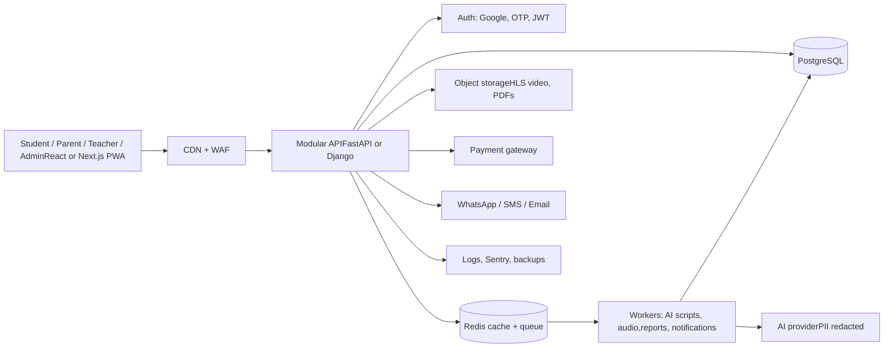

## 2. Roles and permissions

Server-side RBAC. Scope is enforced by family, class or tenant ID, never client-supplied.

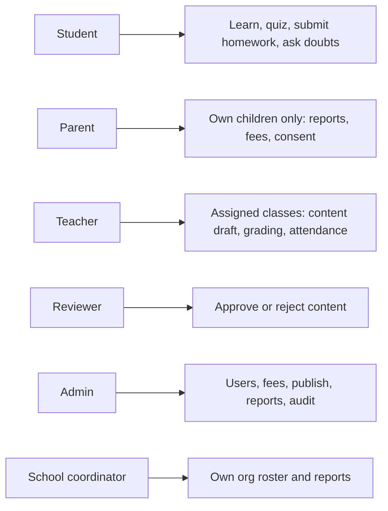

## 3. Authentication: Google, OTP, child profile

Parent signs in with Google or OTP. Children use a profile and PIN under the parent account.

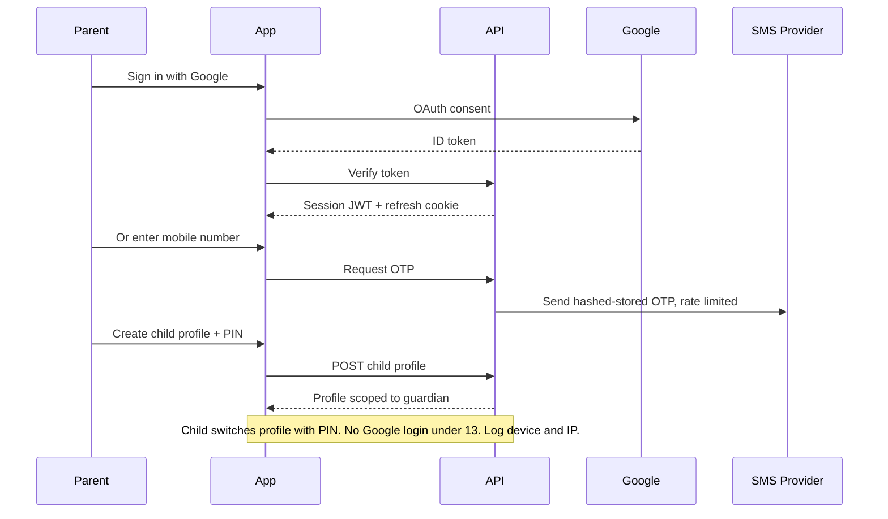

## 4. Guardian consent (DPDP, child safety)

No child data processing until consent is recorded.

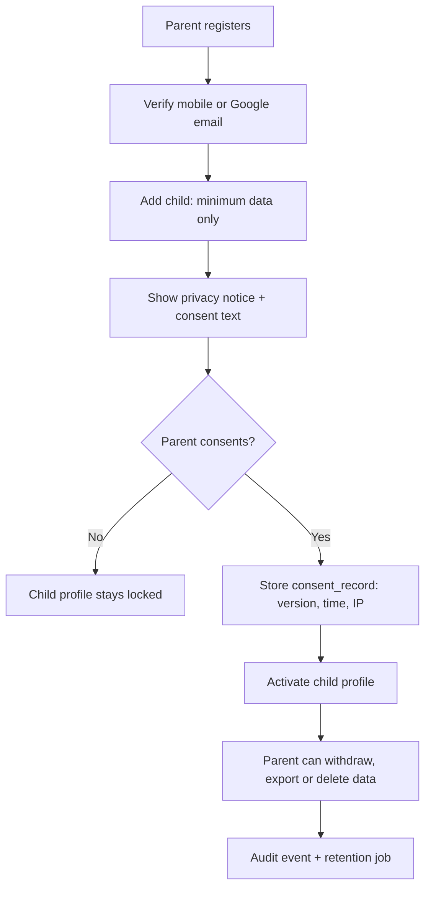

## 5. Data model: curriculum and users (Class 1 to 10, 3 boards)

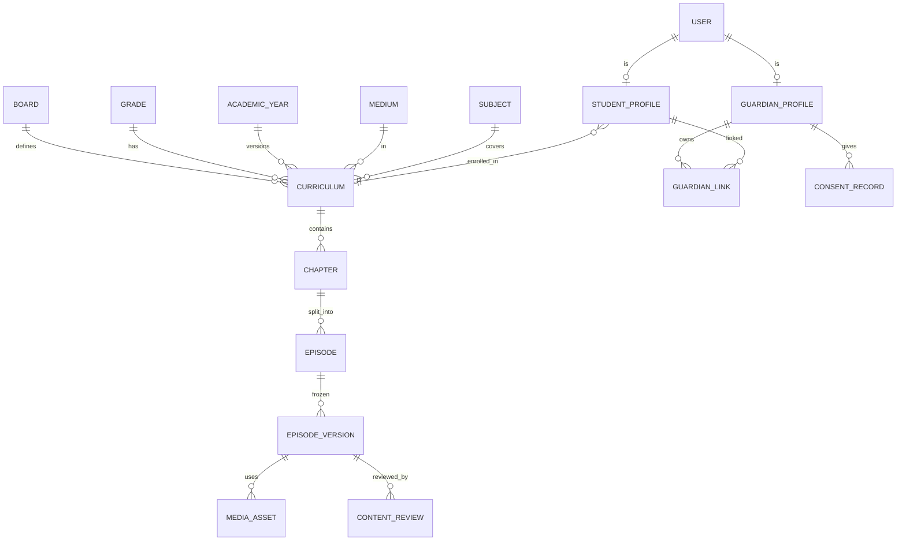

## 6. Data model: assessment, assignments, mastery

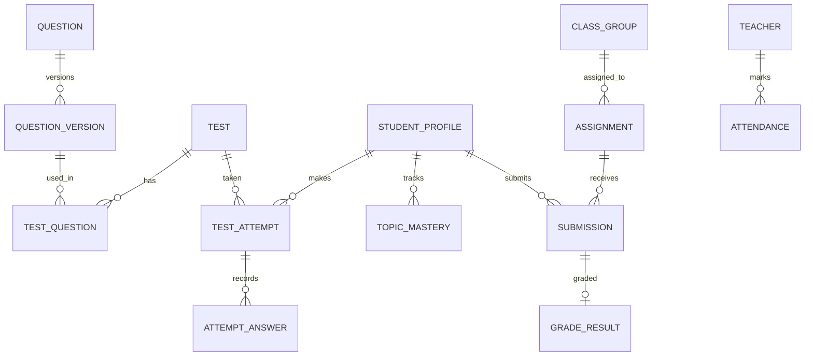

## 7. Data model: fees, subscriptions, notifications

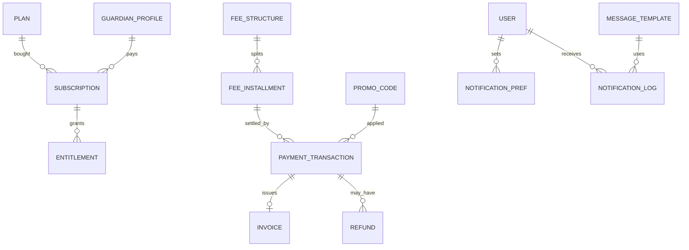

## 8. Content creation and publishing workflow

AI draft can never go public without reviewer approval (AT-08).

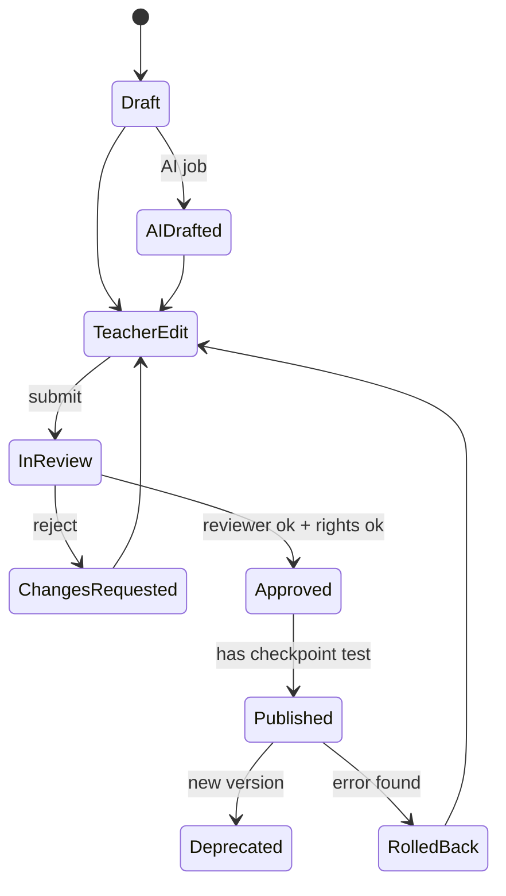

## 9. Student learning journey (episode-first)

For Class 1 to 4: audio-first, short episodes, picture questions, parent-assisted mode.

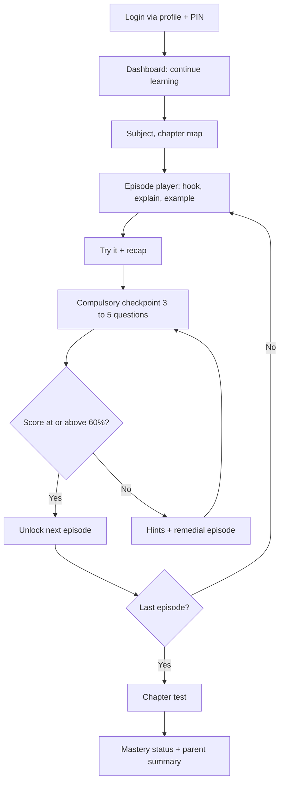

## 10. Assessment scoring and mastery engine

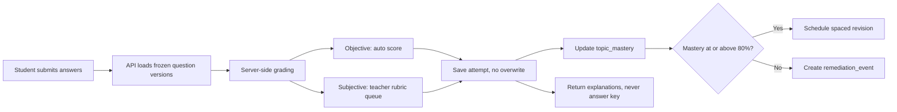

## 11. Homework and assignment lifecycle

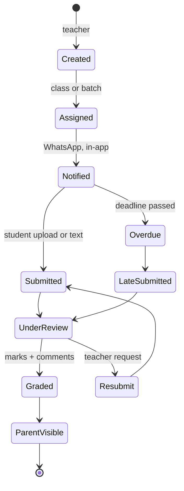

## 12. Fee payment and reconciliation

Frontend return is not proof of payment. Only a signed, idempotent webhook activates access.

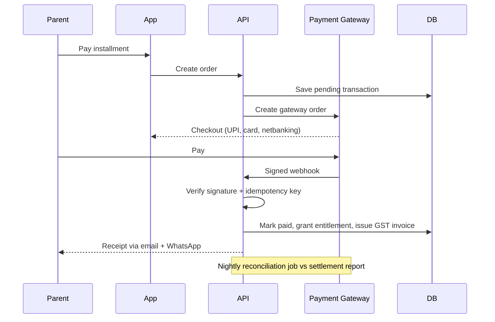

## 13. Subscription and entitlement states

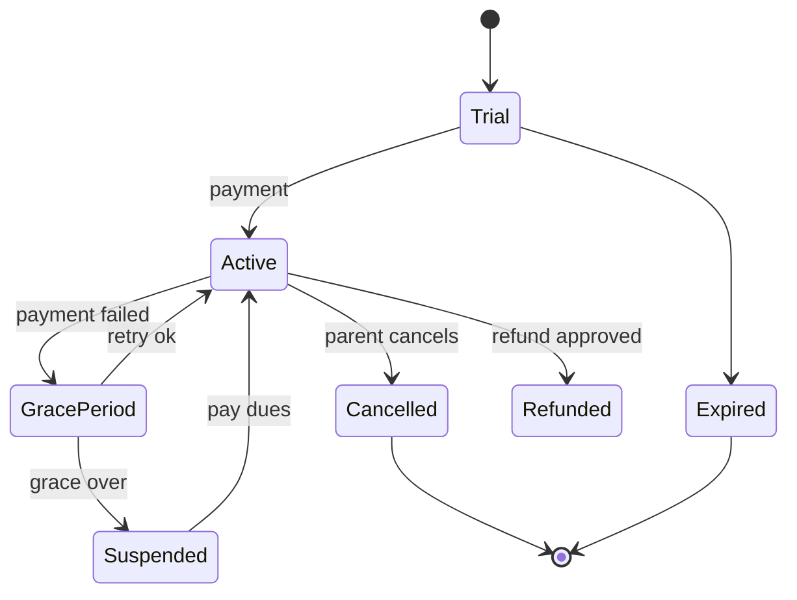

## 14. WhatsApp, SMS and email notifications

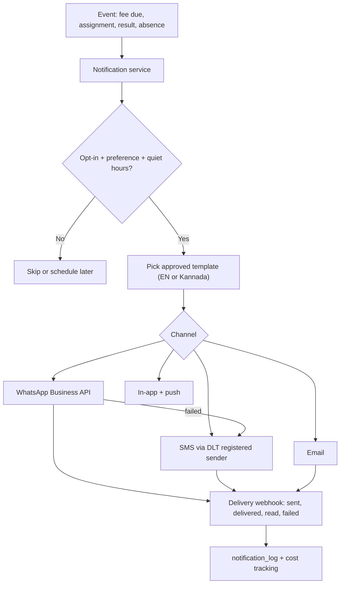

## 15. AI doubt tutor with child-safety guardrails

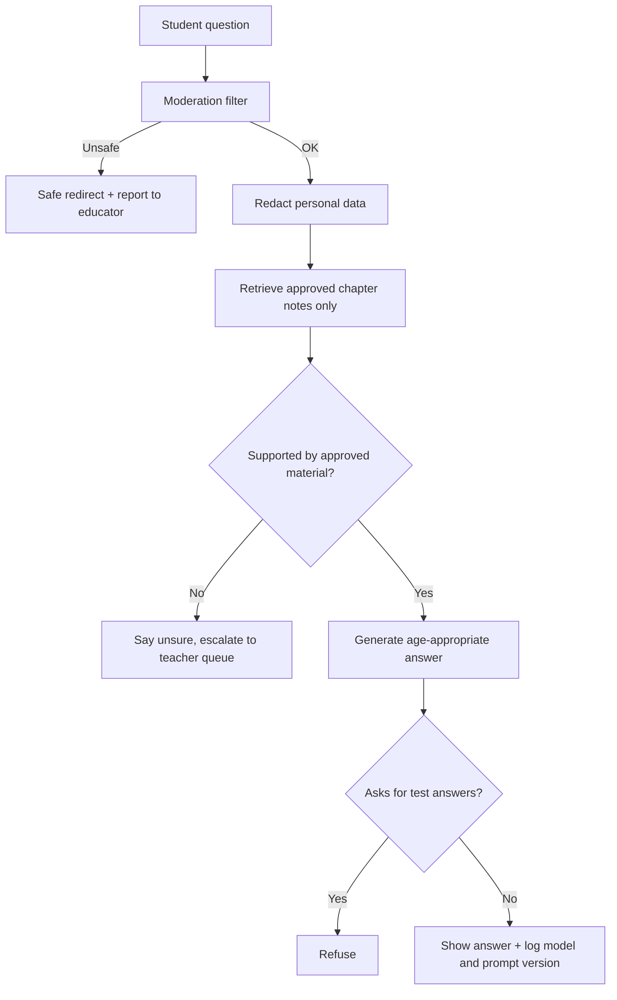

## 16. Teacher / faculty module

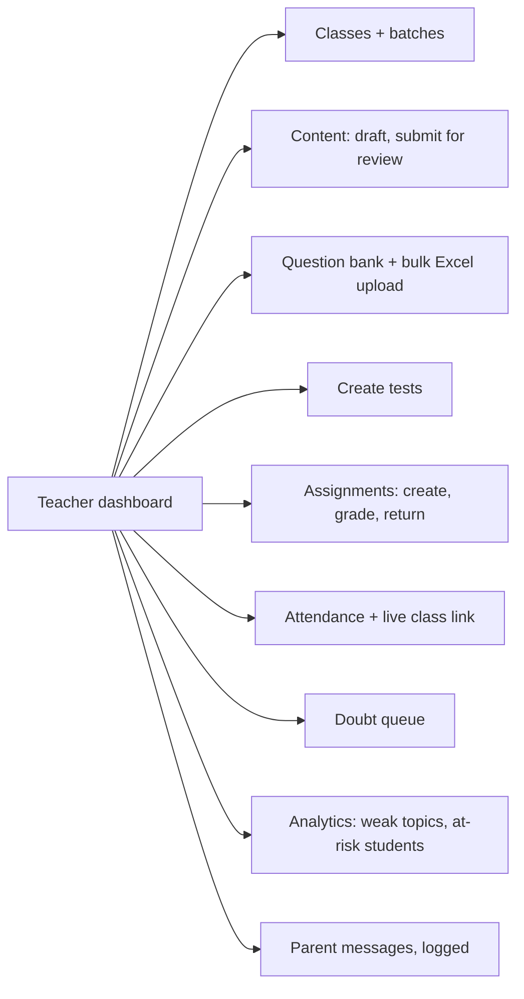

## 17. Parent module

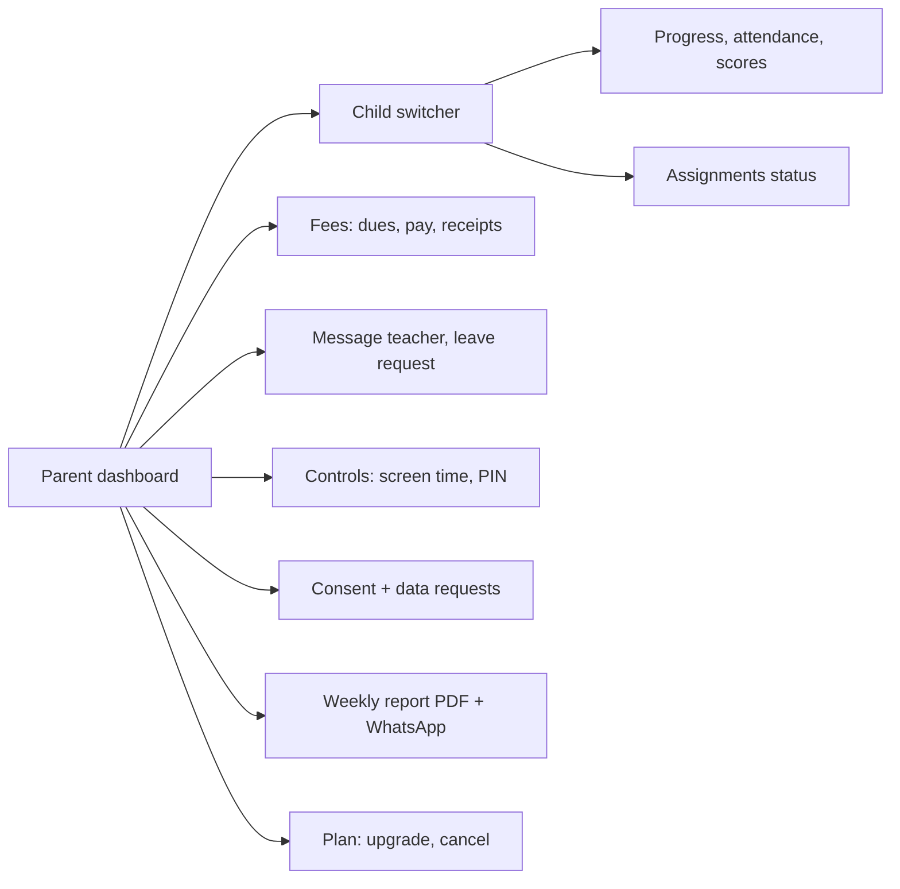

## 18. Admin module map

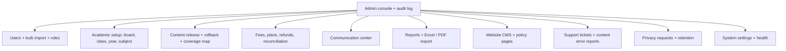

## 19. Deployment, CI/CD and operations

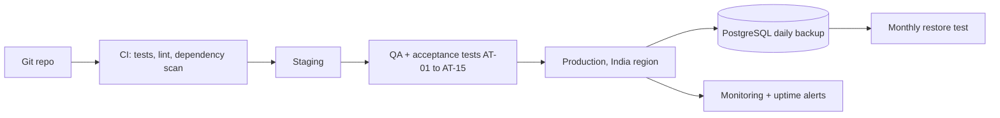

## 20. Attendance and live classes

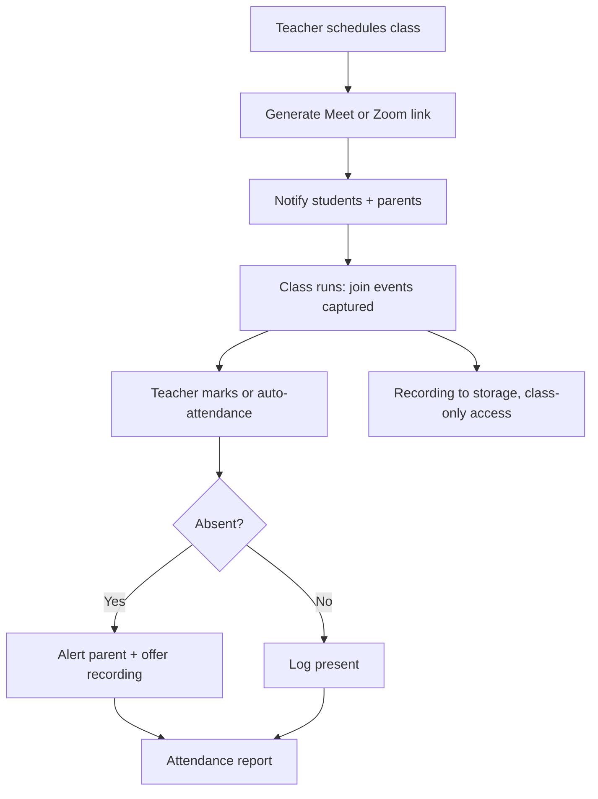

## 21. Bulk import (students, parents, teachers, questions)

```mermaid
flowchart LR
A["Download template"] --> B["Upload CSV or Excel"]
B --> C["Validate: format, duplicates, class exists"]
C --> D{"Errors?"}
D -- Yes --> E["Row-level error report"]
E --> B
D -- No --> F["Preview"]
F --> G["Admin confirms"]
G --> H["Queue job inserts in one transaction"]
H --> I["Invite parents by SMS or WhatsApp + audit log"]
```

## 22. Support ticket lifecycle

```mermaid
stateDiagram-v2
[*] --> New
New --> Assigned: auto-route by category
Assigned --> InProgress
InProgress --> WaitingUser
WaitingUser --> InProgress
InProgress --> Escalated: SLA breach
Escalated --> InProgress
InProgress --> Resolved
Resolved --> Closed: CSAT rating
Resolved --> InProgress: reopened
Closed --> [*]
```

## 23. Extended staff roles

```mermaid
flowchart LR
SA["Super admin"] --> P0["Everything + role management"]
AC["Accountant"] --> P1["Fees, refunds, GST, exports"]
SU["Support agent"] --> P2["Tickets, view-as-user with reason"]
CO["Counsellor"] --> P3["Career guidance, student concerns"]
MK["Marketing"] --> P4["CMS, leads, coupons"]
CP["Content producer"] --> P5["Media upload, no publish"]
SG["Safeguarding officer"] --> P6["Concern cases only"]
```

## 24. Year-end rollover, board and medium change

```mermaid
flowchart TB
A["Academic year closing"] --> B["Snapshot results + archive"]
B --> C["Clone curriculum version"]
C --> D["Diff vs new official syllabus"]
D --> E["Editors review changed chapters"]
E --> F["Promote students to next grade"]
F --> G["Re-map enrolment to new curriculum version"]
G --> H["Parent confirms renewal"]
X["Board or medium change request"] --> Y["Map via concept IDs"]
Y --> Z["Reviewer approves credit"]
Z --> G
```

## 25. Diagnostic test, concept map and prerequisite gap-fill

```mermaid
flowchart TB
A["New student signup"] --> B["Diagnostic test per subject"]
B --> C["Score per concept ID"]
C --> D["Concept graph with prerequisites"]
D --> E{"Prerequisite weak?"}
E -- Yes --> F["Insert earlier-class refresher episodes"]
E -- No --> G["Start at grade chapter"]
F --> H["Personal learning path"]
G --> H
H --> I["Concept map: locked, learning, mastered"]
H --> J["2-minute prior-knowledge check before each chapter"]
```

## 26. Mistake notebook, find-your-error coach, explain-it-back

```mermaid
flowchart LR
A["Wrong answer saved"] --> B["Tag: slip, concept gap, misread"]
B --> C["Mistake notebook"]
C --> D["Find-your-error coach"]
D --> E["Retry similar question"]
E --> F{"Correct?"}
F -- Yes --> G["Mark fixed + spaced recheck"]
F -- No --> H["Suggest remedial episode"]
B --> I["Pattern report to parent"]
J["Explain it back: voice or text"] --> K["Teacher or AI feedback vs rubric"]
K --> C
```

## 27. Safeguarding concern workflow

Legal escalation duties must be confirmed with counsel.

```mermaid
flowchart TB
A["Report a concern button"] --> B["Case created, restricted access"]
B --> C["Safeguarding officer triage within 24h"]
C --> D{"Severity"}
D -- High --> E["Suspend access + escalate per law"]
D -- Medium --> F["Investigate + contact parent"]
D -- Low --> G["Counsel, warn, note"]
E --> H["Audit log + incident report"]
F --> H
G --> H
H --> I["Closure + policy review"]
```

## 28. Teacher analytics: heatmap, grouping, remedial pack

```mermaid
flowchart LR
A["Attempt data"] --> B["Class x concept mastery matrix"]
B --> C["Heatmap"]
C --> D["Auto-group by shared misconception"]
D --> E["One-click remedial pack: worksheet + recap + 5Q retest"]
E --> F["Assign + notify"]
B --> G["Question difficulty calibration + flag bad keys"]
B --> H["Parent meeting prep sheet"]
```

## 29. Parent engagement and wellbeing signals

```mermaid
flowchart TB
D["Weekly job"] --> A["Parent coach card, Kannada or English"]
D --> B["Smart schedule from school, tuition, sleep hours"]
D --> C["Rules: inactivity, late-night use, rapid wrong answers"]
C --> E["Gentle prompt only, no diagnosis"]
A --> H["Send via WhatsApp + app"]
F["Trusted adult invite"] --> G["Read-only access with expiry"]
I["Meeting booking + NPS survey"] --> H
```

## 30. Lead-to-admission funnel (CRM, demo, referral, chatbot)

```mermaid
flowchart LR
A["Landing page or ad"] --> B["Lead form + WhatsApp bot"]
B --> C["CRM lead"]
C --> D["Demo class booking, trial limit per phone"]
D --> E["Follow-up reminders"]
E --> F{"Converts?"}
F -- Yes --> G["Plan + payment + referral coupon"]
F -- No --> H["Nurture messages, opt-out honoured"]
G --> I["Conversion analytics"]
```

## 31. Safe gamification, streaks and exam countdown

```mermaid
flowchart TB
A["Effort events: episode, revision, fixed mistake"] --> B["Points + badges"]
A --> C["Streak with shield on quick revision"]
B --> D["Mastery map regions unlock"]
E["Exam date set"] --> F["Countdown pack: plan + mocks + weekly readiness note"]
G["Improvement vs own history"] --> H["Top improver scholarship"]
D --> I["Private to child and parent, no public leaderboard"]
```

## 32. Learning tools around the episode player

```mermaid
flowchart LR
P["Episode player"] --> L["3 levels: Simple, Standard, Challenge"]
P --> F["Formats: video, audio, illustrated text"]
P --> S["Interactive simulations"]
P --> M["Maths step checker"]
P --> G["Diagram label, drag-drop, map practice"]
P --> ST["Story mode, Classes 1 to 5"]
P --> K["Karnataka context examples, teacher verified"]
P --> W["Exam answer-writing trainer"]
P --> N["Notes, bookmarks, flashcards, mind maps"]
P --> HW["Handwritten maths photo, teacher review, OCR assist only"]
```

## 33. Language lab, voice and accessibility

```mermaid
flowchart TB
M["Student mic with parent consent"] --> A["Speech to text: Kannada, English, Hindi"]
A --> B["Pronunciation + fluency score"]
B --> C["Teacher samples and reviews"]
A --> D["Voice commands + voice doubts"]
M --> X["Audio auto-deleted after retention period"]
E["Accessibility settings"] --> F["Dyslexia font, read-aloud highlight, extra-time flag, data saver"]
```

## 34. Content trust, error reports and AI cost control

```mermaid
flowchart LR
A["Official syllabus source watcher"] --> B["Change detected"]
B --> C["Task for human editor"]
C --> D["Review + republish version"]
D --> E["Trust label: reviewer, board, year, date + AI disclosure"]
F["Student or parent reports error"] --> G["Triage"]
G --> D
G --> H["Thank-you badge"]
I["AI spend tracker"] --> J["Daily limits + cached approved answers"]
```

## 35. Low-bandwidth, prefetch and offline quiz queue

```mermaid
flowchart TB
A["App checks network"] --> B{"State"}
B -- Slow --> C["Lightweight mode: text + audio under 2 MB"]
B -- Offline --> D["Cached episodes + offline quiz queue"]
B -- Wi-Fi --> E["Prefetch next episode"]
D --> F["On reconnect: sync answers"]
F --> G["Server grades + resolves conflicts"]
```

## 36. Feature flags, view-as-user, releases and A/B tests

```mermaid
flowchart LR
A["Feature flag service"] --> B["By board, class, org, percentage"]
G["A/B tests"] --> A
C["Support agent: view as user"] --> D["Reason required + time limit + audit"]
E["Release pipeline"] --> F["Release notes + maintenance banner + rollback"]
```

## 37. Finance, terms versioning and copyright takedown

```mermaid
flowchart TB
C["Payment"] --> D["GST invoice, e-invoice if applicable"]
A["Refund approved"] --> B["Credit note"]
B --> E["Accounting export for Tally or Zoho"]
D --> E
F["Terms or policy update"] --> G["New version + forced re-accept"]
G --> H["terms_acceptance log"]
I["Copyright complaint"] --> J["Unpublish, log, notify, review"]
K["Content licence register"] --> J
```

## 38. Class 1 to 4 experience

```mermaid
flowchart TB
A["Primary profile"] --> B["Icon home + voice navigation"]
B --> C["Story-mode episode, 5 to 8 min, audio-first"]
C --> D["Picture or voice answer, drag and drop"]
D --> E["Stars, no scores shown to child"]
E --> F["Parent-assisted summary in Kannada or English"]
```

## 39. Partners, study buddy, mentors, add-ons, passport

```mermaid
flowchart LR
subgraph T["Partner tenancy"]
T1["org_id on every table"] --> T2["Partner portal"] --> T3["Revenue share report"]
end
subgraph B["Study buddy"]
B1["Teacher creates session"] --> B2["Two students join"] --> B3["Preset questions, reactions only, no free chat"]
end
subgraph M["Mentors"]
M1["Background check"] --> M2["Approved"] --> M3["Moderated session, parent visible"]
end
subgraph A["Add-ons and records"]
A1["Olympiad, holiday bridge, counselling"] --> A2["Entitlements"]
A3["Learning passport, shared on parent approval"]
end
```